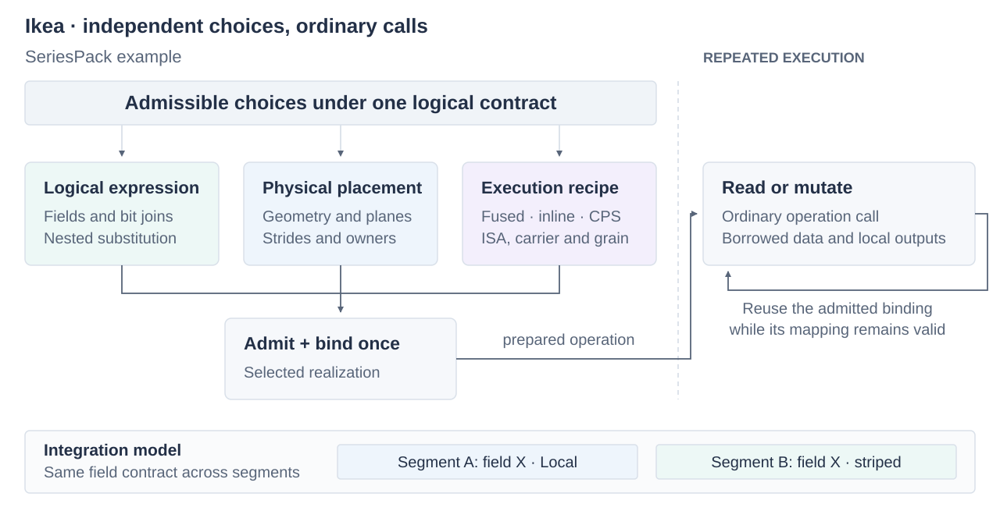

# Ikea

Ikea supplies composable data containers, codecs and computational kernels for
SixDB. Its parts serve records, indexes, strings and standalone structures such
as hash tables and sketches. Engine chooses field semantics and representations.
Packed primitives borrow caller-supplied storage; owning containers expose their
allocation and lifetime policies.

Start with [Building fast consumers](docs/consumers.md) for operation choice,
preparation reuse, fusion, masks and measured tradeoffs. The module guides below
provide the concrete calls and maintained examples.

| Choose a component | Physical model | Start here |
| --- | --- | --- |
| Frame | Composable integer stages over SeriesPack: intervals, bounds, exact aggregates and checked immutable group images | [Use](docs/frame/usage.md) · [Reference and source map](docs/frame/reference.md) |
| SeriesPack | Packed unsigned arrays, 1–64 bits per value; tiled payload and optional head planes | [Use](docs/seriespack/usage.md) · [Physical tour](docs/seriespack/representation.md) · [Compose](docs/seriespack/extending.md) · [Reference](docs/seriespack/reference.md) |
| TuplePack | Fixed-layout units containing byte-contained unsigned codes; ordered projections with caller-chosen packet grouping | [Use](docs/tuplepack/usage.md) · [Compose](docs/tuplepack/extending.md) · [Reference](docs/tuplepack/reference.md) |
| Bec | Headless bitset codes sharing one count-tree core: Bec256 for 256 positions; Bec4096 for 4096, with one population/length per body and direct block, count and rank access. The caller retains population, exact body length and location | [Use and choose](docs/bec/usage.md) · [Bec256](docs/bec/bec256.md) · [Bec4096](docs/bec/bec4096.md) · [Representation](docs/bec/representation.md) |
| Intervals | Borrowed ordered search, interval geometry and sparse checkpoints with external filters | [Use and compose](docs/intervals/usage.md) · [Reference](docs/intervals/reference.md) |
| StreamPack | Variable-length byte values; optional used lengths and coordinated packing over its compact reservation geometry | [Use and compose](docs/streampack/usage.md) · [Reference](docs/streampack/reference.md) |
| Hashtable | Compact integer-key sets/maps, Swiss overflow, same-seed growth and mutable accumulation | [Usage](docs/hashtable/usage.md) · [Rationale](docs/hashtable/rationale.md) · [Performance and qualification](../workbench/benchmarks/hashtable/README.md) |

[Unsigned filters](docs/filters.md) return position masks directly from SeriesPack
and TuplePack storage or native values. Their maintained examples cover ordinary
calls, reused projections, opt-in head rejection and shared canonical consumers
inside composed operations.

These modules support construction, reads and replacement, native composition
and source-qualified byte effects. StreamPack also supplies retirement, reverse
byte ownership, rank-preserving packing and selected transfer for owner rewrites.

The [interface guide](docs/interfaces.md) connects placement and prepared calls
across modules, with explicit row/packet coordinates, selection, byte types,
source-qualified effects and headless parent-schema descriptions.
[Selections](docs/selection.md) explains borrowed activity maps and the shared
`ikea::bitset256` value, including coordinate and byte-order rules.

Modules keep logical interpretation, physical placement and execution distinct.
A parent can retain its logical contract across different child representations;
different segments can choose different layouts. Attachment admits placement;
content validation, where required, establishes a reader's content proof.
Bindings retain reusable operation state and checked calls admit each new command.



The [owner integration guide](docs/integration.md) explains how Engine, Loom and
Orbital retain borrowed state and coordinate visibility across bounded Ikea calls.
[Extending and changing Ikea](docs/source.md) covers authoring principles, source
boundaries and validation. Each module's use and composition guides link directly
to its executable examples.

## Build and run

Use the [pinned Linux toolchain](../BUILDING.md). Prefix these commands with
`orb -m ubuntu` from the macOS workspace. For an AVX2 build:

```sh
cmake -S . -B build/ikea/avx2 -G Ninja -DCMAKE_BUILD_TYPE=Release \
  -DSIXDB_MARCH=x86-64-v3 -DSIXDB_TUNE=zen5
cmake --build build/ikea/avx2 --target ikea_validate -j2
```

For ARM, use a separate directory with `-DSIXDB_MARCH=armv8-a+simd` and
`-DSIXDB_TUNE=neoverse-v2`. Run binaries only on compatible CPUs. ISA-specific
requirements live in the [SeriesPack](docs/seriespack/reference.md#execution-profiles)
and [TuplePack](docs/tuplepack/reference.md#routes-and-native-execution) references,
the [Bec256 guide](docs/bec/bec256.md#compose-native-values), and the
[StreamPack reference](docs/streampack/reference.md).

Link `ikea::frame`, `ikea::seriespack`, `ikea::tuplepack`, `ikea::bec`, `ikea::intervals` or `ikea::streampack` and
include the corresponding `<ikea/frame.h>`, `<ikea/seriespack.h>`, `<ikea/tuplepack.h>`,
`<ikea/bec.h>`, `<ikea/intervals.h>` or `<ikea/streampack.h>`.
`ikea_validate` runs the modules' correctness checks, independent wire checks
and examples. For sets and maps, link `ikea::hashtable` and include
`<ikea/hashtable.h>`; [usage](docs/hashtable/usage.md) covers concrete owners and
runtime bindings. For performance measurement and retained comparisons, use the
[SeriesPack](../workbench/benchmarks/seriespack/README.md),
[TuplePack](../workbench/benchmarks/tuplepack/README.md) and
[Bec256](../workbench/benchmarks/bec/README.md) benchmark guides.
