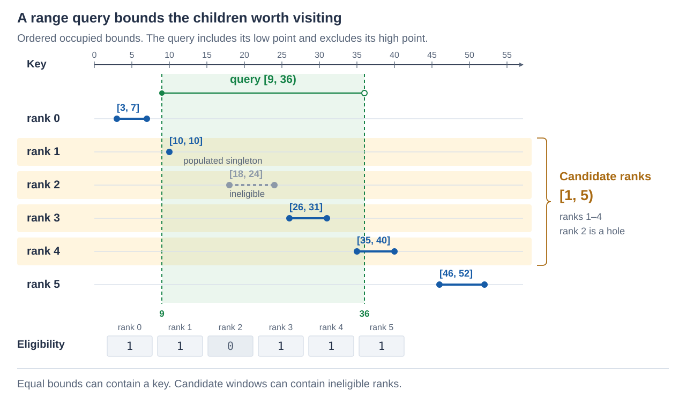
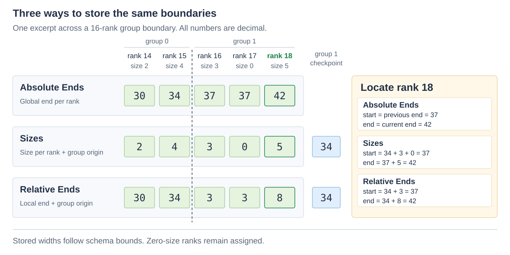
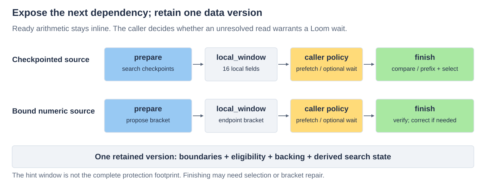

# Boundlist

Boundlist describes **contiguous intervals using ordered cuts**. It locates an
interval by rank, finds the interval containing a point, and finds the first and last
ranks overlapped by a range. It stores geometry and optional retirement bits. The
contents associated with an interval belong to its consumer.

Positions are coordinates in the consumer's domain. An interval's size is the distance
between its cuts; Boundlist does not track which positions contain data.

## Cuts, intervals and ranks

Consecutive cuts `cut[r]` and `cut[r+1]` define interval rank `r` as
**`[cut[r],cut[r+1])`**:
include the left cut, exclude the right. An explicit list of `n+1` cuts defines `n`
intervals. For example, cuts `[10,15,16]` define `[10,15)` and `[15,16)`.
The first interval ends exactly where the next begins.

Here is a larger example, used throughout this guide:

| Rank | Interval | Size |
| --- | --- | --- |
| 0 | `[0,8)` | 8 |
| 1 | `[8,18)` | 10 |
| 2 | `[18,26)` | 8 |
| 3 | `[26,35)` | 9 |
| 4 | `[35,46)` | 11 |
| 5 | `[46,56)` | 10 |

Its cuts are `[0,8,18,26,35,46,56]`. There is no separate start/end pair per rank,
and no gap between intervals. To exclude a span, it must still have a rank; skipping
that rank does not move its cuts or extend a neighboring interval into it.

A **tombstone** marks a retired interval without changing its boundaries or rank.
In the diagram rank 2 is retired. Its span `[18,26)` still exists, and a physical point
lookup still reports rank 2 with its tombstone. Operations selecting live ranks skip it.

## Points, ranges and eligibility

Point lookup uses the first exclusive end **greater than** the point. Thus point 8
belongs to rank 1, point 18 to rank 2, and point 56 lies outside the extent. An interval
with equal cuts has size zero and owns no points.

A range query `[low,high)` intersects each positive-size interval whose end is
`> low` and whose start is `< high`. The result is `rank_window{first,limit}`:
`first` is included, `limit` is one past the last matching rank. An empty answer is
`{n,n}`, where `n` is the assigned interval count.

For the diagram's query `[9,36)`, ranks 1 through 4 overlap: the window is `[1,5)`.
Live-only selection still returns that window because rank 2 is internal; traversal
skips the retired rank. The geometry remains contiguous before and after selection.

## Compact format and borrowed sources

Boundlist's compact mutable format, named `sidecar` in the API, holds up to 256
intervals starting at zero. It stores one exclusive end per rank, or sizes from which
the ends are reconstructed, plus optional tombstones. Zero is the **implicit first cut**.
The final end is the **extent**. The example therefore stores ends
`[8,18,26,35,46,56]`, or equivalent sizes, rather than storing zero again.

Search can also borrow a caller-owned endpoint source, including cuts at a nonzero
origin or in a wider comparison domain. That route has no 256-entry or universal
integer-domain restriction. It searches the supplied values; it introduces no other
contents or hierarchy. [Caller-supplied boundaries](#search-caller-supplied-boundaries)
explains the source-index convention and lower/upper operations.

The [usage guide](usage.md) gives ordinary calls, storage setup and fast consumer
patterns. The rest of this reference covers encodings, operations, borrowed sources
and composition. Boundlist allocates no storage and performs no transaction or scheduling.

## Three geometry encodings

The compact format describes contiguous intervals starting at position zero. An
interval's **exclusive end** is the sum of sizes through that rank. Its start is zero
at rank 0, otherwise the previous end. The last end is the whole source's **extent**.

For sizes `[5,0,8]`, the ends are `[5,5,13]`. Rank 0 owns `[0,5)`, rank 1 owns no
positions, and rank 2 owns `[5,13)`. Position 5 therefore belongs to rank 2. Equal cuts
make a zero-size interval; they do not create a gap. Zero size and retirement are
independent: a live or retired interval can have size zero.

There are three encodings of the same geometry. Checkpointed encodings use groups of
16 ranks; a checkpoint `C[g]` is the absolute start of group `g`.

| Encoding | Stored information | Main tradeoff |
| --- | --- | --- |
| **Absolute Ends** | Absolute exclusive end `E[r]` per rank. | Cheap direct access and endpoint comparisons; fields follow the whole extent bound. |
| **Sizes** | Size `R[r]` per rank, plus one checkpoint per 16 ranks. | Narrow fields and cheap resizing; random starts need a local prefix sum. |
| **Relative Ends** | Group-local cumulative end `L[r]` per rank, plus the same checkpoints. | Direct local lookup and endpoint comparisons; local ends can be wider than sizes. |

A group has one checkpoint, including the first group's zero origin. There are
`(assigned+15)/16` meaningful checkpoints and **no terminal checkpoint**; the directory
reserves capacity for all 16. The final extent supplies the last global end. Relative
ends reset at each group, so their raw field array is not globally ordered.

### Prepare the schema and its field widths

Prepare an immutable `sidecar::layout` from `description`. Its `family` chooses
`geometry::absolute_ends`, `sizes` or `relative_ends`; Sizes remains the default.
The old names `direct` and `width` are aliases for the first two values, not extra
formats.

The schema specifies two independent bounds: per-slot size maximum **M** (`maximum`)
and total extent limit **B** (`extent_limit`). M is at most 65535 and B at most 256M.
For each field, preparation chooses the smallest native carrier among u8/u16/u32 that
can hold its proven bound:

| Field | Bound |
| --- | --- |
| Absolute end or checkpoint | B |
| Individual size | min(M,B) |
| Relative end | min(16M,B) |

Widths are fixed schema facts; a smaller current allocation or occupancy cannot narrow
them. For example, M=4095 permits u16 local ends, while M=4096 can require u32 unless B
proves a tighter bound.

An optional `fixed_size` derives all geometry without stored ends or sizes. A zero-size
domain likewise needs no stored boundaries. `immortal` omits tombstones and therefore
cannot express retirement. These omissions do not remove assigned ranks or their count.

## Geometry access and mutation

### Bind storage before reading or writing it

A sidecar view borrows three disjoint byte windows. They may be spans of one owner
allocation. The layout reports their required extents and alignment. Mutation calls
also take an effects sink that reports source-qualified byte writes to the owner;
the effect plane number identifies the window. Effects do not themselves publish a
transaction or protect readers.
Effect ranges name encoded metadata bytes, not coordinates in the partitioned domain.

| Window / effect plane | Contents |
| --- | --- |
| Directory /0 | Optional 32 B tombstone bitmap, then 256 absolute ends or 16 checkpoints. Fixed/zero geometry omits both end and checkpoint arrays. |
| Lengths /1 | Sizes or Relative Ends fields, in initialized 16-rank groups; absent for Absolute Ends/fixed/zero geometry. |
| Control /2 | u16 assigned count. Variable checkpointed geometry also stores u32 extent at byte 2. |

Directory storage remains full capacity; lengths grow with assigned groups. Unassigned
tails in the final initialized length group are zero and readable, but are not ranks.
Lengths require the stored carrier's natural alignment. All multibyte fields are little
endian. There is no padding or tombstone/checkpoint-interleaving schema switch.

The setup sequence distinguishes placement from contents:

1. Prepare the immutable layout.
2. `view::bind` checks directory/control minimum extents, lengths alignment, pointer
   ranges and disjointness, including nonoverlap with the layout object. It does **not**
   inspect encoded contents.
3. For new storage, `initialize` constructs an empty assignment. For external stored
   content, `validate` checks count, monotonicity/sizes, checkpoints, extent and
   initialized tails before reads.

Successful checked mutations preserve those content rules. Ordinary rebinding after
growth need not rescan unchanged, already-admitted contents. The layout and named view
must stay at stable addresses while an access, phase or effect record borrows them.

### Locate intervals and search positions

| Operation | Result |
| --- | --- |
| `locate(source,rank)` | `{offset,size}` for a live rank; invalid or retired ranks are errors. A live zero-size slot succeeds. |
| `reverse(source,point)` | Optional `position_owner{rank,tombstone}` for a point below extent; otherwise no result. |
| `sidecar::overlap(source,low,high,only_live)` | A half-open rank window covering positive-size intervals overlapping `[low,high)`. Retired intervals participate by default. |
| `range(source,first,count,sink)` | Live ranks and their locations, after checking the complete rank interval before callbacks. |

Reverse lookup finds the first exclusive end **> point**. It includes retired
intervals and never assigns a point to a zero-size interval. It deliberately does not skip
tombstones as eligible endpoint search does. An overlap window can contain internal
zero-size slots. With `only_live=true`, it trims retired/zero-size edge ranks but can
still contain those holes internally. These are skipped ranks within the same
contiguous geometry, not gaps between its cuts.

### Choose the intended edit

| Checked command | Meaning |
| --- | --- |
| `initialize` | Reset directory and control to an empty assignment. |
| `append` | Assign the next slot; initialize a new readable 16-rank group as needed. |
| `retire` | Set the containing tombstone bit; leave geometry unchanged. |
| `set_boundary` | Move one exclusive end while preserving later ends. |
| `resize` | Change one size and translate every subsequent endpoint. |

For example, starting with ends `[5,9,12]`, setting rank 0's boundary to 6 produces
`[6,9,12]`; resizing rank 0 from 5 to 6 produces `[6,10,13]`. Both commands check
size/order/extent bounds and effect capacity before storing. Fixed geometry rejects
incompatible changes. All checked mutation refusals preserve bytes and effect state.

Geometry edits change only metadata. The consuming structure coordinates the
corresponding data change and publication. Inserting, removing or reordering middle
ranks constructs a new representation with an explicit rank remap.

## Search caller-supplied boundaries

The geometry above is Boundlist's compact mutable format, in `boundlist::sidecar`.
The top-level search functions also work directly on caller-supplied ordered endpoints.
They do not require that format, allocate metadata or infer what an endpoint represents.
This permits a nonzero origin, wider comparison domains and existing packed boundaries.

An endpoint source exposes `size()` and `at(index)`. Values must be nondecreasing,
including values excluded from search results. Equal endpoints are allowed. A raw source
indexes exactly the values supplied: an array containing every cut has one more entry
than the intervals between them. The compact format instead supplies one exclusive end
per interval, with zero implicit.

| Operation | Result |
| --- | --- |
| `lower_bound(source,q)` | Index of the first eligible endpoint **>= q**. |
| `upper_bound(source,q)` | Index of the first eligible endpoint **> q**. |

Both return `source.size()` if there is no match. Both find a **first** endpoint;
upper bound does not mean the last matching endpoint. For endpoints `[3,7,7,10]`,
all eligible, querying 7 returns lower bound 1 and upper bound 3.

When the source stores exclusive ends, upper bound finds the interval containing a
point inside the covered extent. When the source contains the initial cut as well,
the containing interval is the preceding index: for cuts `[10,15,16]`, upper bound
of 15 is cut index 2, and the interval rank is 1. Check the first and final cuts before
subtracting; points outside `[10,16)` have no interval. Do not apply eligibility to
this cut-index calculation: selection is a separate operation on interval ranks.

### Endpoint storage and eligibility

`direct_source<T>` borrows an array. Native unsigned arrays permit unaligned loads
within their declared readable bytes. Other element types must be real `T` objects.
Native unsigned searches classify wider or signed integer queries before conversion,
so an out-of-domain query cannot wrap into the stored domain.

A custom source can project `size()` and ordered `at(index)` from an already-bound
decoder. Comparisons require no arithmetic distance or universal integer domain:
byte strings, wider keys and virtual top fences are possible. Source counts and result
indices are `unsigned`, bounded by `maximum_count`.

Every endpoint is initially eligible. `populated_source` attaches a `population`
bitset to filter endpoint results, with `ceil(n/8)` readable bytes and set bits meaning
eligible (`inverted=true` reverses this). It neither changes endpoint values nor joins
adjacent intervals. Excluded values remain ordered and readable.

On the compact format, lower/upper searches skip tombstoned interval ranks, whereas
physical `sidecar::reverse` still reports their ownership. These answer different
questions: the first eligible end after a point can belong to a later interval.

### The two-source overlap helper

`boundlist::overlap(maxima,minima,query_range{low,high})` is a separate search helper
for **two caller-supplied sources**. It interprets each pair as an inclusive interval
`[minima.at(r),maxima.at(r)]`; each source must be nondecreasing and both must have
the same count and eligibility. Those pairs are not an encoding of a list of cuts.
This helper does not change the compact format's contiguous, half-open intervals.

For its default query `[low,high)`, a rank qualifies when `maximum >= low` and
`minimum < high`. `low_closed` and `high_closed` choose query endpoint inclusion;
the defaults are `true` and `false`. A pair with equal endpoints can intersect a closed
point query. In contrast, equal consecutive cuts always enclose a zero-size interval.

The helper returns `rank_window{first,limit}`, excluding `limit`, or `{n,n}` when
empty. Ineligible edges are trimmed; internal ineligible ranks remain in the window.
For contiguous geometry, use `sidecar::overlap(source,low,high,only_live)` instead;
it already applies the half-open cut interpretation and needs no second source.

## Composition and retained versions

### Keep ready geometry work with its consumer

A typed access exposes `start`, `slot_size`, physical `reverse`, carried traversal
and native group decoding. Dispatch once around the complete consumer rather than once
per rank. A sequential traversal carries its position; a native `read16` lets a fused
consumer use offsets, sizes and a live mask without an obligatory intermediate array.
Read callbacks cannot mutate or rebind the source.

The admitted sequential encoder carries new geometry while a consumer chooses movement
and ordering. An in-place rewrite must capture original boundaries before overwriting
them; the shared original-geometry walker and encoder support that coordinated rewrite.

### Retain read dependencies and report writes separately

Read-projection visitors describe an operation's metadata dependencies:
`visit_start_metadata` reports the start path and `visit_metadata` adds size/liveness.
Consumers account for their own additional metadata and payload dependencies. These
are point-read projections, not complete reverse/search footprints. A typed
checkpoint search can read all 16 initialized checkpoints even at partial occupancy.
The owner retains the relevant control, planes and readable padding; a point visitor
is not a universal search grant.

Writes use `before(source,byte_write)` to identify the original source and actual issued
stores, including preserving vector lanes. These **effects** are neither read protection,
beforeimages nor a transaction. A policy can coarsen damage or erase it for authorized
scratch work. Before execution, the owner supplies effect capacity and exclusive authority
over every issued byte.

Inputs, effect storage, source/view/layout objects and writable outputs must satisfy
their alias and lifetime contracts. Hooks cannot fail, allocate, suspend or invalidate
admitted inputs between preflight and stores. Typed `rebind` requires the exact same
layout object, not merely an equivalent description.

### Expose an unresolved read only when useful

`prepare_lower_bound` and `prepare_upper_bound` return a phase whose `finish()`
produces the ordinary search result. When `has_local_read()` is true,
`local_window()` identifies a useful next-read hint. The caller can prefetch or wait
through Loom; Boundlist itself neither waits nor enqueues work. Ready arithmetic and
native/CPS stages remain bounded and inline where useful.

The local window is a hint, **not the complete read/protection footprint**. Selection
can still read eligibility; numeric prediction can correct outside its proposed bracket.
Across any wait, the owner retains one coherent version of boundaries, count,
eligibility, backing and derived search state. Population-aware completion also borrows
the original named source; retaining a temporary typed dispatch object is insufficient.

## Portable descriptor

The portable descriptor is eight bytes. New standalone **version 4** uses byte 0: bits
5–7=`4`, bits 0–1=encoding 0/1/2, bit 2=reserved zero, bit 3=immortal, bit
4=fixed-size-present. Bytes 1–2 hold M, bytes 3–5 hold B and bytes 6–7 hold fixed size
(zero when absent). Version 3 decoding preserves its original two-encoding carrier laws
and re-encodes that version. Prepared objects and pointers are not portable descriptors.
Conversion constructs a new representation; changing a tag does not convert its bytes.

[Owner integration](../integration.md) covers Loom/Orbital visibility, retention and
effects. Performance evidence and algorithm selection live
with the [Boundlist study](../../../workbench/spikes/boundlist/README.md).
