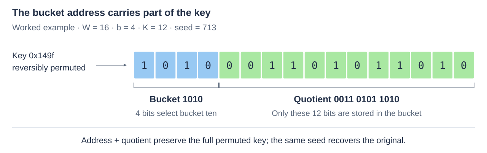
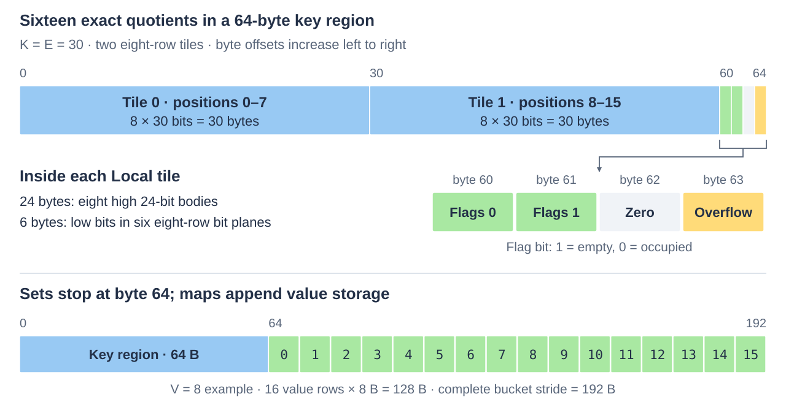
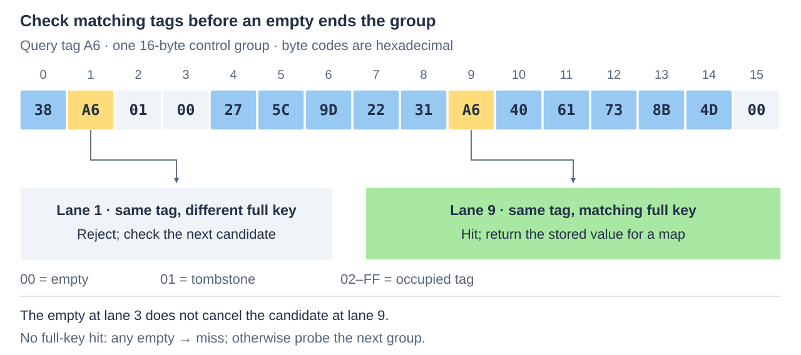
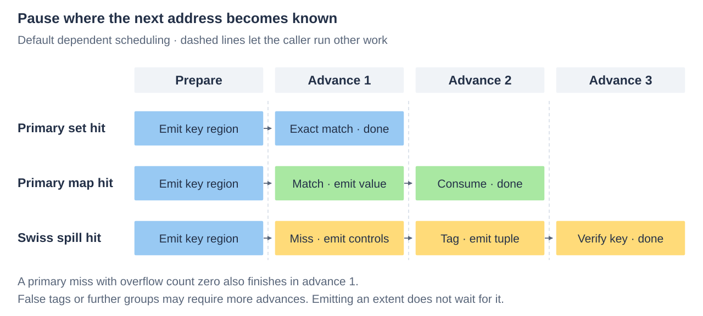
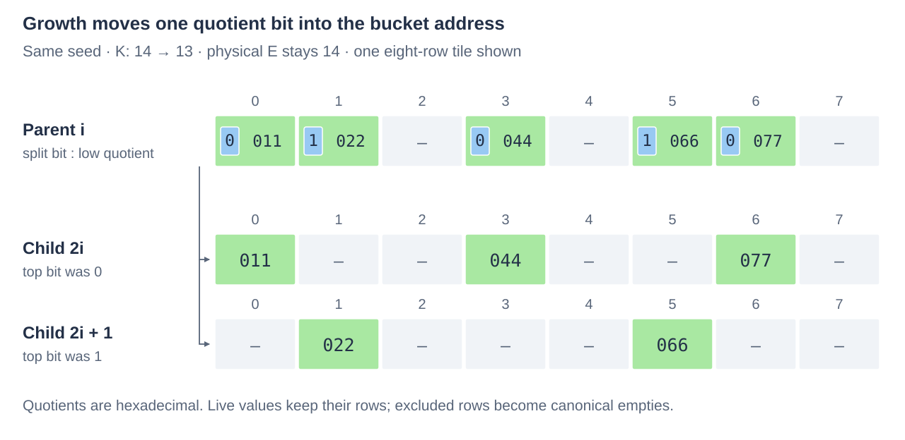

# Why this hash table is shaped this way

Ikea's hash table stores unsigned integer sets and maps with fixed-size byte
values. Its primary buckets make exact membership decisions from a small region
of packed keys. Part of each key is already implied by the bucket
address; storing only the remaining bits reduces the key footprint. A bucket
that fills spills into a shared Swiss-style overflow table.

These choices work together. Small primary buckets keep searches bounded and
local, quotienting makes them dense enough to be useful, and the overflow table
absorbs uneven bucket populations without making every primary bucket larger.
The price is packed comparison work, reserved value rows, and additional
dependent reads on the overflow path. The balance depends on key width, value
width, occupancy, CPU and access pattern.

This document explains that balance and the invariants behind it. Start with
[usage](usage.md) to build a consumer; the
[maintained benchmarks](../../../workbench/benchmarks/hashtable/README.md) own
the measurements. The graduated container supports sets and maps. Owning
multimaps remain separate research.

## An exact primary answer

A fingerprint table first compares short tags, then checks the full keys of
matching candidates. Abseil's [Swiss table design](https://abseil.io/about/design/swisstables)
uses this separation to search many candidates cheaply. Ikea uses the same idea
in overflow, but takes a different approach in primary storage: each stored
quotient contains **all** the bits needed to distinguish keys in its bucket.
A primary match is therefore final. It needs no second key verification.

For a set with a 64-byte, cache-aligned primary bucket, both the exact comparison
and the decision about whether overflow is possible fit in that cache line.
For a map, finding the row can still leave a value read. Wider key regions and
unaligned bucket strides can span more lines. The useful property is an exact
answer within a bounded key region, rather than a universal one-load lookup.

The division into primary storage and a shared overflow store draws on the
front-yard/backyard idea in [Iceberg hashing](https://arxiv.org/abs/2109.04548).
This implementation chooses its own small bucket geometries, permutation,
overflow structure and doubling algorithm. The paper's load, stability and
probability guarantees do not automatically apply to this combination.

## The address stores part of the key

Let a key have `W` meaningful bits and the table have `2^b` primary buckets.
A reversible permutation produces another `W`-bit integer. Its high `b` bits
select the bucket; its remaining `K = W − b` bits are the **quotient** stored
inside that bucket.

For example, split the permuted 16-bit integer `1010 0011 0101 1010` at `b = 4`.
Bucket `1010` stores quotient `0011 0101 1010`. Within that bucket, no other
16-bit key can have the same quotient. The address and quotient together retain
every bit of the permuted key.



The [permutation](../../include/ikea/hashtable/detail/hash.h) starts with one
unsigned 128-bit product:

```text
product  = (key XOR seed) × 0x9e3779b185ebca87
lo       = low 64 bits of product
h        = lo XOR high 64 bits of product

bucket   = high b bits of the low W bits of lo
quotient = low K bits of lo
```

The fixed multiplier is odd, so multiplication modulo `2^W` has an inverse.
Reconstructing `(bucket << K) | quotient`, multiplying by that inverse, masking
to `W` bits and XORing with the seed recovers the original key. Iteration can
therefore return original keys even though primary storage omits their bucket
bits.

The same product also supplies the overflow route: `h` selects a Swiss group,
and its top byte supplies an eight-bit control tag. Codes zero and one mean
empty and tombstone; those two hash-byte values map to tags eight and nine.
The remapping runs only on the overflow path. Primary reads and writes retain
their direct route. This avoids another multiplication; it does not establish
independent or cryptographic hash functions. The caller supplies the seed,
masked to the key domain. Same-seed growth deliberately preserves the permutation.
This multiply/XOR construction
is not a cryptographic defense against chosen-key flooding.

## Fit capacity first, then choose an encoding

There are two primary representations. When `K ≤ 9`, at most 512 distinct
quotients belong to a bucket. A presence bitmap uses one bit per possible
quotient, and the quotient itself identifies the value row. It cannot overflow.
The key region occupies `ceil(2^K / 8)` bytes, including a single byte at `K = 0`.

For `K > 9`, the key region has fixed byte size `B`. It holds complete
eight-row SeriesPack tiles, one empty-flags byte per tile, and one overflow byte:

```text
B = 64 when K ≤ 30; otherwise 96
T = floor((B − 1) / (K + 1))     tiles per bucket
N = 8 × T                       primary rows per bucket
```

Eight `E`-bit integers take exactly `E` bytes in a tile. Its physical encoding
width `E` can be wider than the logical quotient `K`, provided the same `T`
tiles still fit:

```text
K ≤ E ≤ min(64, floor((B − 1) / T) − 1)
```

| Quotient K | Key region B | Tiles T | Primary rows N | Allowed encoding E |
| ---: | ---: | ---: | ---: | --- |
| 12 | 64 B | 4 | 32 | 12–14 bits |
| 14 | 64 B | 4 | 32 | 14 bits |
| 30 | 64 B | 2 | 16 | 30 bits |
| 31 | 96 B | 2 | 16 | 31–46 bits |
| 47 | 96 B | 1 | 8 | 47–64 bits |

Capacity comes from `K`, before selecting `E`. Widening a quotient can simplify
comparison or extraction while consuming otherwise unused bytes. It cannot
silently reduce the row count. This also makes encoding comparisons meaningful:
two encodings of the same geometry have the same primary capacity.

SeriesPack supplies the packed unsigned representation and its comparison and
assignment operations. Here it uses **Local** geometry: within each eight-row
tile, whole bytes of each value precede the low residual bit planes. At `E = 30`,
the tile has 24 bytes for the eight high 24-bit bodies, then six bytes holding
the six low bits across those rows. It is not a stream of sixteen adjacent
30-bit fields. See the [SeriesPack physical tour](../seriespack/representation.md)
for the bit arrangement.



### Empty rows remain distinguishable from every key

All `K`-bit quotients are legal, including zero and all ones. The flags are the
authoritative liveness state: each tile has eight bits, with **one meaning empty**.
The stored contents of an empty row also follow a canonical rule:

- With `E > K`, an empty row is all ones. A live quotient has zero high padding
  bits, so equality with a legal query cannot match that sentinel.
- With `E = K`, an empty row is zero. Only a zero-quotient query needs its
  comparison result intersected with liveness.

The flags remain necessary for vacancy selection, deletion, iteration and
growth even when equality can avoid reading them. Erasure restores the sentinel.
Construction and rebuilding initialize padding too: for example, byte 62 in
the illustrated K30 bucket is zero. Wide comparison recipes may read these
initialized bytes while remaining inside the admitted bucket extent.

## Keep values compact without making every value a scattered read

For a map, each bucket's value storage follows its key region. Let `V` be the
value size in bytes and `R = max(8, N)` the number of reserved value rows:

```text
bucket stride = B + R × V
```

Values divisible by eight bytes are contiguous per row. An eight-byte map has
an array of eight-byte values; a 64-byte map keeps each value's eight limbs
together. Separating those limbs into eight distant arrays would turn one
complete-value read into several cache-line dependencies.

Other widths use full eight-byte limb planes followed by a residual plane.
For `V = 9`, the first plane contains eight bytes per row and the second one
byte per row. For `V < 8`, there is just one plane, so values are contiguous.
The common read/write operation assembles a complete `bytes<V>` value through
SeriesPack operations; the caller never needs to know whether its bytes were
contiguous. Overflow tuples use TuplePack projections to read a byte-contained
full key and value limbs from adjacent tuple bytes.

This layout has two costs worth keeping visible. Value storage is reserved for
every primary row, even when empty. Also, the combined stride determines bucket
alignment. K30 sets have a 64-byte stride and eight-byte maps a 192-byte stride,
both preserving cache-line alignment. K30 nine-byte maps have a 208-byte stride;
some 64-byte key regions cross a line. A 96-byte region is likewise not a promise
of two cache lines for every value width. The implementation derives its
alignment from the actual stride.

## Overflow preserves exactness and bounds the primary search

A full primary bucket sends additional keys to one table-wide Swiss store.
The store has separate control bytes and full-key/value tuples. A control group
contains 16 one-byte controls on every ISA, including AVX2 and AVX-512. Codes
`00` and `01` mean empty and tombstone; `02`–`FF` are occupied tags. SIMD equality
selects candidates, which must be verified against their full keys. A hit ends
the search immediately. If no candidate matches, any empty control in that
group ends the search with a miss; tombstones do not terminate it. The rule
applies to the whole group, rather than stopping at the first empty lane.
Triangular stepping visits groups in a power-of-two table. Ordinary
insertion grows the store when live entries plus tombstones would exceed its
seven-eighths threshold.



Larger vector registers do not make larger logical groups free. A wider group
can skip several probing steps in a dense table, but it also presents more tags
that might trigger unnecessary full-key reads. Those reads matter more when
tuples are cold. The [Zen 5 width comparison](../../../workbench/spikes/hashtable-swiss-probes/RESULTS.md)
retains 16-byte groups: dense hot-miss gains from 32/64-byte groups did not
outweigh cold-read losses. Eight-bit tags were promoted; filtered continuation
and a higher occupancy ceiling were not.

Vector comparison width is separate from logical group width. Ordinary reads
batch four logical groups with AVX-512BW, two with AVX2, and one otherwise.
The reader masks candidates beyond the first group containing an empty before
checking any tuples, while keeping every candidate within that group. This
preserves the original full-key check order and avoids the extra tuple reads of
wider logical groups. Groups follow triangular order, so the next four may need
separate loads even though their comparisons share one vector.

The implementation computes their addresses independently. It reconstructs a
physical slot only for a surviving tag candidate and computes continuation only
when needed, avoiding an array of group addresses spilled on every lookup.
This policy stays inside the out-of-line ordinary read helper. Mutation and
staged cursors retain one-group steps, and small stores use the scalar reader.
Metadata lookahead can still fetch control regions that a scalar probe would
not reach; masking candidates does not make all lookahead traffic free. The
[batch qualification](../../../workbench/spikes/hashtable-swiss-batch/GRADUATION.md)
records whole-table reads/writes and the accepted tradeoffs of this ISA default.

The primary bucket's overflow byte avoids consulting this store unnecessarily:

| Byte | Meaning after a primary miss |
| --- | --- |
| 0 | No key from this bucket is in overflow; return absent |
| 1–254 | Exact number of live spilled keys; overflow must be checked |
| 255 | Count saturated; overflow may contain the key |

Deleting a spill decrements an exact count. Removing the last one restores the
early-miss shortcut. Once saturated, the byte stays conservative through
deletions; rebuilding into a new owner reconstructs counts. Saturation reflects
the live count reaching its limit, not the cumulative number of historical
insertions.

A primary deletion leaves a hole rather than moving an overflow key back.
Consequently, an insertion cannot take a vacant primary row until it has checked
for an existing copy in overflow whenever the byte is nonzero. Otherwise an
update could create two copies of one key. The mixed upsert's admissible-vacancy
mask encodes this rule; the slow resolver proves absence before using a hole.

## Specialize complete consumers, and expose memory dependencies

The logical format does not prescribe one search instruction sequence.
Construction can select a CPU/ISA/value-width profile that chooses both `E`
and a search kernel. The native lookup then has no profile dispatch. Shared
SeriesPack comparisons supply the general path; selected recipes combine
comparisons across tiles or retain a first candidate in registers before
checking residual bits. NEON, AVX2 and AVX-512 have different profitable recipes.

These boundaries are chosen using complete consumers. A locally shorter helper
can make its caller spill registers. In particular, the direct reader keeps
the Swiss search behind `read_overflow`, an out-of-line boundary, so its probe
state and prepared TuplePack controls do not burden the primary loop's register
allocation. A selected AVX-512 eight-row/eight-byte-value recipe loads keys and
values together and selects the matching value in registers. Its barriers retain
the intended scheduling in generated code; they are not synchronization fences.

Independent requests can overlap memory accesses: issue a prefetch, do other
work, then inspect the data. `prepare`/`prefetch`/`finish` expose the first primary
access. The staged reader goes further by returning the next extent when its
address becomes known: primary row to value, overflow control to candidate tuple,
or one control group to the next.



This is a resumable probe, not an internal scheduler. Loom can interleave probes
in its prefetch ring; a warm consumer can call the direct reader instead. The
optional eight-byte value lookahead emits all primary value lines with the key
region, trading extra traffic for one fewer dependent visit on a primary hit.
Heat, prefetch distance and whether to yield belong to the enclosing consumer.

## Mutations expose their physical effects before writing

The ordinary owner is useful for private tables and externally excluded
mutation. Two upsert strategies retain the same representation:

- `mixed` shares insertion and replacement stores, including idempotent packed
  key and flag writes. It favors traffic where branching on presence is costly.
- `existing` writes only the value on a primary hit, while still supporting new
  keys. It avoids packed key read/modify/write work for update-heavy traffic.

`modify` and `modify_or_insert` additionally combine resolution and caller
computation. The updater receives a complete temporary value; only its completed
result is stored. This gives an inlinable increment, aggregate or reference
replacement without exposing a pointer into a potentially striped value.

For retained versions, preservation or journaling, guarded operations add a
caller-supplied protocol: enter with stable access, resolve and check capacity,
prepare all damage ranges, publish them through nonthrowing `before` hooks, then
perform the stores. Guarded RMW runs its updater after preparation succeeds and
before damage publication. Refusal does not invoke it; an updater exception
precedes live stores.

Damage describes physical writes rather than only the logical key. Ordinary
guarded insertion/deletion can cover an entire primary bucket and the header.
Existing-key guarded RMW instead publishes just its value spans, including the
separate spans for a partial final limb. This lets a containing representation
preserve bytes at its chosen granularity. The enclosing owner resolves each
live source to an incarnation and generation, and owns protection, publication
and rollback policy. A pointer and byte offset alone are not an MVCC identity.

Packed rows share bytes, and operations also change counts and Swiss state.
Logical locks on distinct keys therefore do not establish independent physical
writers. Worker-local owners and an explicit fold avoid that contention; shared
mutation needs exclusion or private backing supplied by the caller.

## Same-seed growth turns a key bit into an address bit

Doubling the bucket count changes `b` to `b + 1` and `K` to `K − 1`. With the
same permutation, parent bucket `i` splits by the top quotient bit:

```text
child bucket = 2 × i + top_bit(quotient)
child quotient = remaining low K − 1 bits
```

When the old and new layouts have compatible tile geometry and encoding,
growth partitions live masks and clears the split bit directly in the packed
tiles. Row positions survive. With matching strides, the parent image, including
values, can first be copied into both children. Excluded rows become canonical
empty rows; their old value bytes are unreachable. Geometry, encoding and bitmap
transitions instead relocate live rows. Swiss entries are inserted into the new
owner last, allowing newly available primary rows to absorb them.



Growth constructs an independent owner. Allocation failure leaves the source
unchanged, and a descriptor replaces its owner only after construction succeeds.
A captured reader can keep the old owner alive across replacement. That lifetime
guarantee does not freeze an owner that is subsequently modified in place.

### Accumulation makes destination ownership explicit

`accumulate(destination, source, reducer)` combines coherent sources into an
exclusive destination whose backing is already prepared. It preserves sources
and reuses that backing throughout. With a shared seed, primary entries route
between geometries by moving bits between address and quotient; full original
keys need only be recovered where the Swiss path requires them.

The caller can start from an empty final geometry, transfer a disposable worker
owner, or explicitly clone one. This keeps copying and allocation visible and
allows the same movement operation to serve different publication policies.
Sources are applied one at a time in caller order. For a duplicate key, the
reducer receives the current destination value and then the incoming value;
associativity is not required. A failed or throwing accumulation leaves a
disposable, potentially partial destination, which the caller must discard.

## Where the trade-off pays

The maintained evidence supports compact sets and narrow maps, mixed mutations,
same-seed growth and independent reads with useful prefetch distance. It also
retains hot hit losses, weaker bare-AVX2 cells, construction costs and ARM
accumulation losses. Wide values reduce the relative benefit of key compression.
Packed comparisons and extra dependent overflow accesses remain real costs.

Read results must distinguish dependent serial latency from independent
throughput. Likewise, allocation byte counts, accessible pages and process RSS
measure different things. The current recurring suite measures independent and
prefetched consumers and reports preparation separately for accumulation;
buffer conditioning does not prove every access came from DRAM. Historical
serial and Loom measurements have their own retained scope. See the
[benchmark guide](../../../workbench/benchmarks/hashtable/README.md#what-a-number-means)
and [accumulation qualification](../../../workbench/benchmarks/hashtable/ACCUMULATION.md)
before generalizing a result to a consumer.

The source follows these mechanisms: [geometry](../../include/ikea/hashtable/geometry.h)
fixes capacity; [bucket operations](../../include/ikea/hashtable/detail/bucket.h)
own physical access; [table](../../include/ikea/hashtable/table.h) owns lookup and
mutation; [growth](../../include/ikea/hashtable/rebuild.h) and
[accumulation](../../include/ikea/hashtable/accumulate.h) construct or combine
owners. The [figure generator](images/generate.py) checks the illustrated
geometry, key recovery and row split against those sources.
