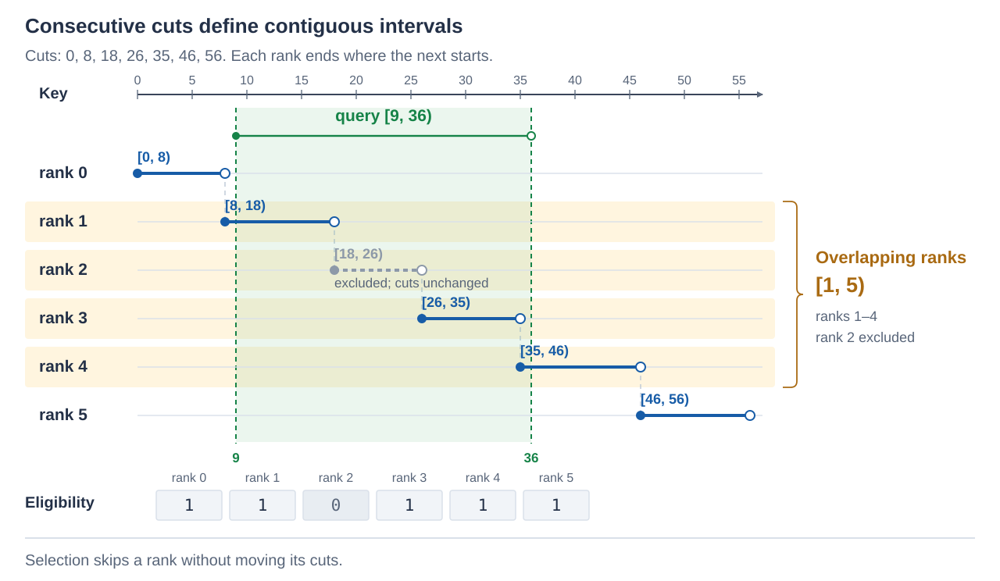
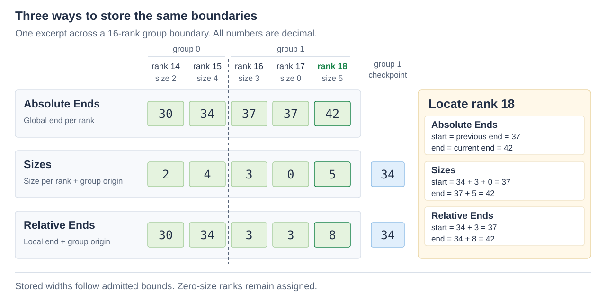
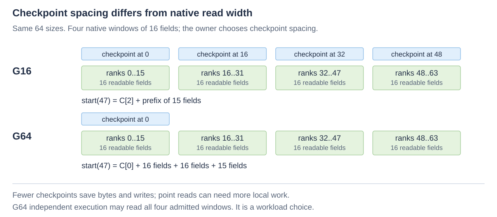
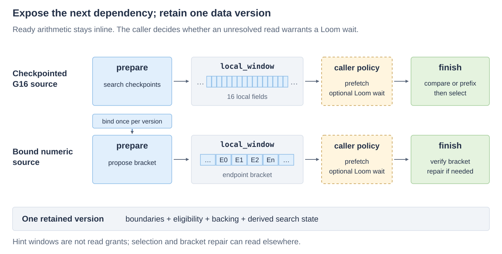

# Using Intervals

Intervals searches ordered endpoints and partitions ordered domains into contiguous,
half-open intervals. A rank identifies one endpoint or interval. It borrows an
existing array, decoder projection or checkpointed source; the same operations do
not require a compact header or a particular storage owner.

Link `ikea::intervals` and include `<ikea/intervals.h>`. The
[reference](reference.md) specifies exact semantics and read grants. The executable
[ordinary example](../../examples/intervals/ordinary.cpp) starts with cuts and
selection; [composition](../../examples/intervals/composition.cpp) covers packed
endpoints, staged search, reusable numeric bindings and independent queries.

## Bind cuts, then use interval ranks

Pass the whole cut array to `from_cuts`. It copies the origin and count while
borrowing the ends, normalizing `n+1` cuts to `n` interval ranks. Keep the cuts
ordered and coherent throughout an operation; renew the adapter after changing
its origin, count or backing placement.

```cpp
#include <ikea/intervals.h>
#include <array>
#include <cassert>

namespace in = ikea::intervals;
const std::array cuts{0u, 8u, 18u, 26u, 35u, 46u, 56u};
const auto geometry = in::from_cuts(std::span(cuts));
assert(geometry.size() == 6);
const auto bounds = in::locate(geometry, 2);
assert(bounds && bounds->first == 18 && bounds->limit == 26);
assert(in::reverse(geometry, 18u) == 2);
assert(in::reverse(geometry, 56u) == geometry.size()); // final cut excluded
const auto window = in::overlap(geometry, 9u, 36u);
assert((window == in::rank_window{1, 5}));
```



`reverse` finds the containing interval; absence is the interval count.
`overlap` returns a half-open **rank** window, so `[1,5)` means ranks 1 through 4.
Queries can extend beyond either end. Equal cuts define zero-size intervals:
`locate` returns their bounds and rank traversal visits them, but they own no
points and do not intersect a coordinate range. Internal zero-size ranks can
remain inside an overlap window.

If storage already contains one exclusive end per interval, use
`from_ends(endpoint_source, origin)`. A custom geometry supplies `size()` as
`unsigned`, `origin()` and ordered `at(rank)` exclusive ends. Counts can exceed
256, origins can be nonzero, and coordinates can be strings or logical key
references. Ordering suffices; geometry need not compute a distance between keys.

## Search endpoints without adding geometry

`lower_bound(source,q)` finds the first endpoint **>= q**; `upper_bound` finds
the first **> q**. Both return `size()` when absent. For ends `[3,7,7,10]`,
querying 7 returns lower bound 1 and upper bound 3.

An endpoint source needs only `size()` returning `unsigned` and ordered
`at(rank)`. It needs no origin, arithmetic or equality operator. Use
`direct_source{data,count}` for an unsigned array, or project `at` from an
already-bound SeriesPack/TuplePack decoder. Keep attachment and schema preparation
outside the query loop; no temporary decoded endpoint array is necessary.
Native unsigned arrays permit unaligned reads within their granted bytes.
Signed or wider integer queries are classified before narrowing, so -1 does not
wrap into a large unsigned endpoint. Other domains keep their own comparison law.

This distinction matters to Directory: its logical key source compares exactly
K bytes, including suffixes after byte 8. It remains a `size()+at()` projection.
Physical interior routing uses upper bound over separators after row 0;
logical interior routing uses lower bound to preserve equal-fence routing.
Intervals does not choose the tree's routing policy.

## Attach selection only when needed

Raw geometry includes every assigned rank. Attach eligibility without changing
boundaries:

```cpp
const std::array bits{std::byte{0x3b}}; // eligible: 0, 1, 3, 4, 5
const in::selected_source selected{geometry, in::selection::bits(0, bits)};
assert(in::reverse(selected, 20u) == selected.size()); // rank 2 excluded
assert(in::reverse(selected, 26u) == 3);
assert((in::overlap(selected, 9u, 36u) == window));
unsigned rank_sum = 0;
assert(in::range(selected, window.first, window.limit - window.first,
    [&](unsigned rank, auto bounds) { rank_sum += rank; }));
assert(rank_sum == 1 + 3 + 4);
```

The excluded rank still spans `[18,26)`; its coordinates are not reassigned.
Selected overlap trims excluded or zero-size edge ranks, but internal holes can
remain. Traverse through the same selection to skip them. `range` checks the
complete rank interval before its first callback; eligible zero-size ranks are
visited too. You can instead pass a `selection` as the last argument to
`locate`, `reverse`, `overlap` or `range`, or to `start` after the rank.

A nonempty selection supplies `ceil(n/8)` readable bytes. Set bits mean eligible;
`selection::complement(0, bytes)` borrows an owner's exclusion plane. Empty selection selects none;
`selection::all()` selects all. Intervals never allocates, mutates or
retires those bits. Retain them with the geometry they describe.

Selected endpoint search can skip an excluded rank and return a later eligible
endpoint. That differs from ownership: `reverse` returns absent when the physical
owner is excluded. NULL, presence, tombstones and coarse block selection remain
separate meanings. Frame's one-bit-per-block mask skips descriptor, geometry and
body **before** entering an operation; empty groups are skipped by the outer owner.
An entry-rank filter cannot replace that early skip.

## Choose a source from the data you already have

| Existing representation | Borrowed source | Important cost or proof |
| --- | --- | --- |
| Native or logical ordered endpoints | `direct_source`, or a custom `size()+at()` projection | One endpoint per rank; preserve the actual comparison domain. |
| G16 sizes and group origins | `delta_source<W,P>` | Prefix reconstruction within one native window. |
| G16 group-relative ends | `relative_end_source<L,P>` | Add one checkpoint; local ends must fit L. |
| Sizes with fewer checkpoints | `sparse_sizes<G,W,P>` | Fewer checkpoints, more local prefix work for random ranks. |
| Ends relative to sparse checkpoints | `sparse_ends<G,L,P>` | Direct local lookup, but larger G can widen L. |
| Decoded u64 differences or checkpoint-relative fields | `wide_sizes`, `wide_ends` | Borrow fields/checkpoints from a parent decoder; modular reconstruction needs no ordering. |
| Immutable u8 ends-minus-one | `run_end_source` | Logical exclusive ends are 1..256; native-byte search serves every count. |
| Constant size | `fixed_source<P>` | No boundary plane; owner proves coordinate arithmetic cannot wrap. |



Checkpoint spacing and native execution width are different choices. Sparse G
can be any multiple of 16 from 16 through 256; local prefix kernels still process
16 fields. One checkpoint gives the absolute start of each G-rank region,
including the origin; there is no terminal checkpoint. The owner supplies the
final extent. Larger G saves directory bytes and checkpoint writes, but random
starts must accumulate more local fields. Relative ends may need a wider carrier:
a G16 field fitting u8 may need u16 at G64, overwhelming checkpoint savings.



This source borrows 128 sizes, two checkpoints and a nonzero 64-bit origin:

```cpp
std::array<std::uint8_t, 128> sizes;
sizes.fill(7);
constexpr std::uint64_t origin = 1ull << 40;
const std::array<std::uint64_t, 2> checkpoints{origin, origin + 64 * 7};
const in::sparse_sizes<64, std::uint8_t, std::uint64_t> source{
    sizes.data(), checkpoints.data(), 128, origin, origin + 128 * 7, 7};
assert(in::start(source, 70) == origin + 70 * 7);
assert(in::reverse(source, origin + 70 * 7) == 70);
```

All native windows that an operation can read must be initialized and readable,
including the final partial 16-field window. Size padding is zero; inactive lanes
never become ranks. `stride`, in width elements, permits interleaved siblings.
An optional `CheckpointCapacity` template argument grants actual initialized,
readable checkpoint lanes; it never increases the logical checkpoint count.
Use the [reference's grant table](reference.md#readable-backing-and-carriers)
before supplying either promise. These borrowed sources define no portable schema.

Serial execution is the default. `source.for_independent_reads()` is an explicit
G64 prefix option over the same bytes. It can combine four admitted windows before
one reduction, helping random independent rank requests; it can lose on dependent,
clustered and range workloads. Inverse routing stays serial. The measured benefit
covers u8 on Zen 5 AVX2/AVX-512 and V2 NEON, plus V2 u16; x86 u16 earns no such
recommendation. Keep G16 for hot point workloads unless measured storage/edit
savings justify sparse checkpoints. [Native findings](../../../workbench/spikes/intervals/RAISE-BAR.md)
retain the gap, losing cells and disassembly rather than claiming a universal win.

## Keep ready work with its consumer

Use `range` for consecutive ranks: carry the previous end rather than computing
another prefix at every rank. `with_geometry(source, body)` resolves any source's
typed representation once around the complete useful operation. Sources can
provide start-only, size, owner and carried traversal hooks without requiring a
flattened descriptor or a decoded packet.

For start plus an independently stored used length, `start(source,rank)` avoids
reconstructing an unused reservation size. Inside an already-admitted typed body,
`start_unchecked` avoids another checked/optional handoff. Its caller has proved
rank, selection and readable backing. Read callbacks cannot mutate or rebind inputs.

The three live consumers use this seam differently:

| Consumer | Use | Keep with its owner |
| --- | --- | --- |
| StreamPack | Common kernels inside its typed, fused complete value reads and carried packing walks | Compact schema, count/extent, U, bitmap/retirement, payload movement and effects. Use the public StreamPack value API. |
| Directory | Direct u32 separators and exact K-byte logical projections with ordinary lower/upper search | Tree-specific fences, selected child/Object access and coherent Scope lifetime. |
| Frame | `wide_sizes`/`wide_ends` over decoded fields and separately framed checkpoints; `run_end_source` for the research run stage | Fitting/image laws, offset-binary interpretation, block masks and retained frame lifetime. |

A namespace migration alone does not accelerate a caller. The
[live caller audit](../../../workbench/spikes/intervals/AUDIT.md) distinguishes
actual complete readers from geometry-only controls and records the selected use
for each consumer.

## Stage only a useful dependency

A named source's `prepare_lower_bound` / `prepare_upper_bound` does ready routing
now and exposes a `finish()` returning the ordinary result. Checkpoint routing
may identify one local 16-field window, or up to G sparse fields. The caller may
prefetch that window and yield through Loom if the read is cold; Intervals neither
waits nor enqueues work. Measure scheduling/refill/drain costs before adding a wait
to a hot group.

```cpp
const auto pending = in::prepare_lower_bound(source, origin + 70 * 7);
if (pending.has_local_read()) {
    const auto next_read = pending.local_window();
    // Owner may prefetch or wait here while retaining one coherent version.
}
assert(pending.finish() == 69); // first exclusive end >= the query
```



A local window is a hint, **not the complete read/protection footprint**.
Checkpoint routing already reads metadata; selection can read eligibility, and
numeric prediction can repair outside its proposed bracket. Keep the named source,
backing, count, interpretation, eligibility and derived state coherent until
completion. Two retained images with different checkpoint choices can coexist.
Retention, publication and reclamation belong to the caller.

For repeated numeric queries, opt into `<ikea/intervals/author/search.h>` and
`author::bind_search(direct_source)`. Reuse its derived state only for the unchanged
version; rebuild after endpoint, count or placement changes. `author::scan_source`
provides a small hot-list comparison, and `author::lower_bounds` / `upper_bounds`
interleave independent native queries. Preparation, exact repair for duplicates or
skew, complete child/value consumption and reuse count determine whether they pay.
Logical key domains do not need a numeric model.

An owner that can admit initialized, read-isolated bytes beyond a short array can
say so with `author::with_readable_window<32>(source)`: a nonempty source then
grants `max(count*sizeof(T), 32)` readable bytes from `data`. On AVX2 and NEON,
arrays under 32 bytes then count with one load instead of overlapping pieces whose
size depends on the count, which matters when counts vary from request to request.
Allocator capacity or page locality alone is not this grant, and a mutable or
protected neighbour must stay outside it. AVX-512 already reads short arrays
exactly with masked loads.

## Edit borrowed sizes without adopting a storage owner

`size_editor<G,W,P>` borrows disjoint mutable size/checkpoint spans and named
assigned-count/extent controls. It provides checked append and resize, with no
allocator, compact descriptor, bitmap or publication policy. Placement,
disjointness, initialized/admitted contents and exclusive write authority are
owner proofs; `validate()` checks contents and capacities. A new empty image has
assigned count 0 and extent equal to origin. Append initializes newly readable
16-field tails and new checkpoints before assigning a rank.

```cpp
#include <ikea/effects.h>
std::array<std::uint8_t, 64> widths{};
std::array<std::uint32_t, 1> origins{};
unsigned assigned = 0;
std::uint32_t extent = 0;
const in::size_editor<64, std::uint8_t> editor{
    widths, origins, assigned, extent, 0, 4096, 255};
assert(editor.validate());
std::array<ikea::journal::entry, 32> records;
ikea::journal effects{records};
assert(editor.append(3, effects));
assert(editor.append(0, effects));
assert(editor.append(5, effects)); // ends [3,3,8]
assert(editor.resize(0, 4, effects)); // ends [4,4,9]
```

Resize changes one size and translates all subsequent endpoints; it is not a
one-boundary-preserving edit. The owner performs corresponding payload/child
movement and publishes that with geometry. Reordering or removing middle ranks
requires a replacement and an explicit rank remap.

Checked refusal preserves bytes and effect output. Each issued store reports
`before(editor, plane, offset, size)` on the original named editor, including preserving
and tail stores. Reserve effect capacity before execution and keep the editor
stable until records are resolved. Hooks are infallible and cannot allocate,
suspend or invalidate inputs. Effects do not retain readers or commit a transaction.
Follow [owner integration](../integration.md) for allocation, visibility and
retention; an old reader needs its old coherent geometry and associated data.
