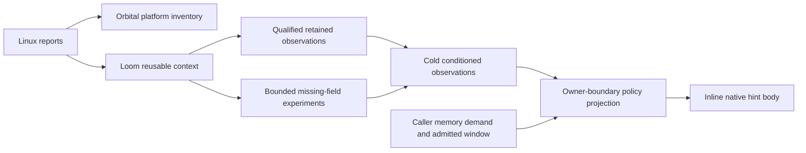

# Hardware knowledge in Loom

Loom owns hardware interpretation, bounded experiments and scheduling policy.
Orbital supplies reported platform facts, worker affinity, physical storage and
lifetimes. Ikea supplies kernels and formats over admitted byte windows.
Engine and Shore compose useful operations; their runtime
callers are still to be built. Loom examples and the composed StreamPack/Object
drivers currently exercise these seams.

For caller setup, start with [demand binding and policy adoption](#bind-demand-and-adopt-policy).
For reported and calibrated fields, see [inspection](#inspect-and-use).

## Organising model

Reported shape, measured behavior and current-worker decisions have different
lifetimes. They have separate native representations:

| Representation | Meaning and owner |
| --- | --- |
| Orbital `PlatformReport` | A cold report of CPU identities, advertised features, cache geometry and CPU memberships, SMT/core/package/NUMA relationships and page options; unavailable facts remain optional |
| Loom `HardwareContext` | Canonical CPU/environment identity for conservative behavior-table reuse; its signature includes kernel, cache geometry/sharing width, page policy, SMT and governor facts |
| Loom `HardwareObservations` | Immutable conditioned evidence, independent field origins and qualification outcomes, method/control version and measurement scope |
| Loom `HintProfile` / `HintPolicy` | Compact policy projection copied by the owner between native spins; safe address envelopes and provisional performance choices |



Physical CPU labels and actual sharing memberships stay in the inventory. They
are deliberately separate from the CPU-number-independent lookup key. Equivalent
contexts may share one calibration handle; that handle records the CPU actually
sampled, not the current worker's physical domain. Neither equal cache geometry
nor a matching kernel proves equivalent NUMA residence or foreground pressure.
The reuse signature is a compatibility adapter for the retained study format;
it uses a narrower set of reported inputs than the detailed inventory. Adding
inventory fields does not silently widen the applicability of old observations.

Inventory describes what Linux reports. An advertised instruction feature does
not prove that an instruction or PMU event is usable by this process. Page
options and pool counters do not promise an allocation. Actual mapping receipts
remain with the experiment; cache residence is never a reported platform fact.

`HardwareService` coalesces bounded local probes for missing behavior. The owner
copies the selected policy at a returned boundary. Native callbacks execute
admitted inline hint bodies without a clock, hardware query, profile lock or
atomic read. Physical reporting is independent of calibration: it remains useful
when experiments are disabled, unsupported, cancelled or inconclusive.

## Bind demand and adopt policy

Use the [hint example](../examples/hints.cpp) for a complete startup-to-cleanup
consumer. Set up an optional shared `HardwareService`, discover the actual
context, request its profile and attach the handle in `configure`. Known/default
fields are available immediately while one coalesced background job calibrates
missing fields. A complete known hit needs no calibration. Choose the service's
memory/time allowance and retain it through cancellation/join; those bounds are
cooperative, including scheduling and VM calls. Workers without a service use
reported geometry and provisional defaults. Native execution need not wait for
calibration to finish.

Callers describe `MemoryDemand` as irregular or linear access with an approximate
extent. `bind_demand` rounds it down to one of eight extent classes for that
pattern, bounded by the minimum contiguous qualified window at every later
address.
The smallest class needs one occupied byte; it does not permit a complete
cache-line load. The resulting class is small operation state: bind once, then use
`ring.prefetch(class, address)` or `MemoryDependency` at admission. No per-address
size/null validation belongs inside the emitted hint body. Activity, physical
lifetime and version/content stability must already qualify each address.

Separate planes need separate demands. An address envelope spanning a gap does
not authorize hints through that gap. Random starting addresses followed by
contiguous consumption are not a trained stream across requests. The product
uses its existing bounded class mapping; the alternative contiguous/unique-line
emitters remain experimental. Fixed `Hint` controls remain available for matched
mechanism comparisons, with their own stride/page qualification.

After a spin returns, call `refresh_hints(worker)` and then
`ring.refresh_hints()` to adopt newly qualified fields. `set_hint_pressure`
accepts a caller's coarse low/busy observation; the mapping is provisional,
not an automatic pressure sensor. Pending frames retain their admitted class
envelopes. Geometry stays fixed until close/rebind, and a width candidate does
not resize a live bank. Native visits read no hardware, clock, profile atomic or
lock. Keep inspection through `inspect()` on cold paths.

The retained behavior table is compiled into Loom;
[its generator](../tools/generate_hardware_table.py) checks the original context
keys and input hash. Runtime lookup uses no Python or subprocess. A missing or
partial match preserves unknown fields rather than extending old observations
to an unqualified environment. Neither training, neighbor benefit nor the width
candidate is per-address heat or a promise that the next load will be cheap.
Use caller facts or the [execution policy](execution.md) for operation choice.

### Stage demands and fixed locality controls

Bind separate `DemandClass` values for independently qualified stage windows,
such as primary metadata, overflow control bytes and a later value. Normal
callers describe irregular/linear access and extent; the current hardware and
pressure mapping selects the hint body. A larger extent is not a request to
target a farther cache level. Current irregular demands select a first-line
L1 hint at low pressure or L2 at busy pressure; this mapping is provisional.
It does not currently infer a cache tier from execution-policy evidence.

For matched L1/L2/LLC experiments, `<loom/hints.h>` exposes fixed controls:

| Use | Maintained interface |
| --- | --- |
| Bind an initial address and its actual qualified bytes | `bind_dependency(Hint::l1_1, bytes, page_bytes)` returning `BoundDependency`; pass it to `Ring::push` |
| Bind a fixed shape once for later stage addresses | `bind_hint_shape(Hint::l2_1, minimum_bytes, page_bytes)` returning the admitted `Hint` |
| Emit that admitted shape at a later address | `prefetch_selected(hint, address, HintGeometry{64, page_bytes})` |
| A compile-time single-line mechanism control | `prefetch<Hint::l1_1>`, `prefetch<Hint::l2_1>` or `prefetch<Hint::l3_1>`, with the qualified address and page/line geometry |

`Ring::prefetch` takes an abstract DemandClass; fixed later-stage controls use
the free functions above. Binding can downgrade an oversized fixed shape, so use
the returned Hint. The fixed controls preserve their original 64-byte stride;
match the Ring's page geometry. For a compile-time control, the caller must
establish the shape/window proof before the native region. Select a concrete
stage at setup when that removes runtime selection from the measured body.

These names request prefetch locality, not exclusive L1/L2/LLC placement or a
readiness guarantee. `l3_1` uses builtin locality 1; it is not a portable promise
about an LLC. Keep each target active and qualified, including speculative
later-stage hints. For dependent loads, hint and rotate before consuming the target;
known-ready arithmetic may stay in the current visit. The
[Ring guide](ring.md#dependent-prefetch-and-admission) owns those transitions.

## Automatic characterisation

Experiments answer concrete questions about access histories. They produce
conditional observations before policy selects a convenient candidate. Random
encoded-pointer chains expose a useful overlap curve; separated cold/hot/trained
controls expose response to a demand sequence. Independent seeds and repetitions
test transfer. Inconsistent controls, censoring, unsupported maintenance and
incomplete work are distinct unknown outcomes, not invented hardware constants.

Cold observations retain compact width curves and prefetch controls, candidate
widths, field origin and qualification, plus the tested footprint, CPU, protocol
and actual page/NUMA receipts. A partial retained hit may combine retained width
with locally learned training or adjacency; those origins remain independent.
The retained isolated 256-MiB width study is distinguishable from a local 64-MiB
or caller-selected mapping that may overlap useful foreground work. A shared
handle does not make those histories interchangeable.

The startup planner asks only for missing fields, uses one serial background
thread and bounds mapping, scratch and cooperative elapsed work. It rechecks the
reported context around calibration. Known facts survive incomplete, failed,
timed-out, cancelled or contradictory work. A returned terminal state means the
attempt settled; the per-field record says what was actually learned. There is
no generic experiment registry, persistent learned-profile cache, global pressure
observer or online causal-model fitting in this implementation.

Automatic reverse engineering here means controlled variation of history and
qualification of its observed response. A named prefetch engine, exact miss-slot
count, internal table capacity or servicing tier requires additional discriminating
evidence. The native observations and standalone sweeps keep those hypotheses
separate from their results. Storage and transport experiments have their own
device/route/endpoint identities and operation histories; CPU recognition cannot
qualify their costs.

## Inspect and use

The [native inspection example](../examples/hardware.cpp) emits JSON containing
the detailed reported inventory, reusable context, initial/final policy and cold
observations. Reporting runs without starting experiments by default:

```sh
orb -m ubuntu cmake --build build/clang/release --target loom_example_hardware
orb -m ubuntu build/clang/release/loom/loom_example_hardware --cpu 0
orb -m ubuntu build/clang/release/loom/loom_example_hardware \
  --cpu 0 --calibrate --force-miss --mib 16 --budget-ms 2000
```

Choose an allowed CPU from the caller's actual mask. Calibration may settle with
unknown fields; its success is not required for inventory or foreground work.
`HardwareProfile::inspect()` captures policy and its immutable observation record
under one lock for cold clients that need both. Previously acquired records stay
unchanged after publication. Ordinary Worker adoption keeps using the small
`snapshot()` interface. The [independent report check](../tools/check_hardware_report.py)
compares native inventory with Linux and the spike's independent discovery;
[the native worker entry](../tools/hardware-native.sh) retains reported and
calibrated views with actual hardware checks.

The final native inspection delivery was checked on Zen 5, Granite Rapids and
Neoverse V2. Each report matched independent Linux discovery and passed the
platform, hardware-service and inspection checks. Forced misses used 16-MiB
mappings and a 2-second cooperative allowance. Before/after receipts on all
three hosts verified base pages, no huge pages and all 4,096 pages on reported
node 0. These are actual placement receipts for those mappings, not a placement
guarantee for future allocations.

Both x86 runs learned a width candidate of 24, a training candidate of 3, and
their forward parities independently; Zen observed benefit, Granite no benefit.
The V2 run learned width 24 while recording training/adjacency as unsupported.
Those small local sweeps may overlap foreground work and use a different
history/footprint from the standalone matrix and retained 256-MiB campaign. They
are qualification/transport evidence, not universal tuning recommendations.

| Native cold report | Recoverable evidence |
| --- | --- |
| Zen 5, `20261012T234533Z-6505e250` | [reported and calibrated views](../../workbench/spikes/memory-characterisation/evidence/platform-zen5-20261012/artifact.json) |
| Granite Rapids, `20261012T234533Z-5a3b7d08` | [reported and calibrated views](../../workbench/spikes/memory-characterisation/evidence/platform-granite-rapids-20261012/artifact.json) |
| Neoverse V2, `20261012T234533Z-f9256d39` | [reported and calibrated views](../../workbench/spikes/memory-characterisation/evidence/platform-neoverse-v2-20261012/artifact.json) |

The selected views retain compact controls and scope. Full binaries, sources,
compiler/build/check logs remain in the verified worker archives. Injected tests
also cover restricted/heterogeneous topology, malformed reports, offline NUMA
IDs, supplied-versus-retained origins, rejected/partial observations and coherent
immutable publication. Native, ASan/UBSan with always-UAR and TSan checks pass.

The [memory-characterisation spike](../../workbench/spikes/memory-characterisation/README.md)
has supplied these implemented pieces:

| Finding | Implemented use |
| --- | --- |
| Reported line/page geometry and environment identity | Native discovery, qualified envelopes and exact-context lookup |
| Random-chain overlap curve | Conditional scheduling-width candidate, conservative table import and bounded fallback |
| Stream-training suffix with separated controls | Training-access candidate; disagreement and censoring preserve unknown |
| One-demand forward neighbor | Two parity observations in the cold snapshot, qualified table import and bounded fallback |
| Useful work during initialization | Immediate known/default fields, one coalesced background job and returned-boundary adoption |

`HintPolicy` maps sixteen pattern/extent classes through a coarse hardware and
pressure snapshot. Its envelopes are checked; its performance mapping remains a
heuristic. A width candidate does not establish miss-slot count or resize a live
Ring. The profile revision advances when a missing field qualifies, and known
fields survive failed, cancelled, incomplete or contradictory probes. Calibration
is conditional on its foreground environment and stays local.

## Forward-neighbor observations

`HardwareSnapshot::adjacent_forward[parity]` uses the starting cache-line parity
within a native page. Its states are `unknown`, `observed_benefit` and
`no_observed_benefit`. A positive observation concerns the next line after one
demand at randomized regions under separated cold/hot controls. A negative
observation concerns that same history. Neither identifies a named hardware
prefetch engine, a servicing cache level, or present residence of an address.

On cold control paths, callers can read a startup handle's snapshot when choosing
an experiment or operation shape. This observation may inform a comparison of
one-line and two-line reads. It does not authorize a wider load, promise the
second line is already ready, or justify omitting a second software hint:
software-prefetch triggering is measured separately. Cross-page observations
also need separate evidence. The
[controlled diagnostic](../../workbench/spikes/memory-characterisation/ADJACENT.md)
retains those controls and their timing horizons.

The generator imports prefetch facts only from the corrected control protocol,
which fences before conditional demand/hot stimuli. Older fleet results remain
historical: their helpers allowed speculative untimed loads. Their independent
random-chain width candidates remain usable, while training and adjacent fields
stay unknown until corrected calibration or independently qualified new evidence.

The runtime fallback measures only missing parities on x86 with supported cache
maintenance. It uses two seeds and two repetitions per parity, balanced cold/hot/
single-demand arms and the configured memory, deadline and cancellation bounds.
Each parity qualifies independently. ARM maintenance is unsupported by this
production probe and leaves the field unknown; startup never installs a signal
handler or forks to test an instruction in the threaded process.

## Findings that remain research

Cache capacities and sharing widths are retained in the signature. Actual
cache-domain CPU lists and visible NUMA topology are exposed in Orbital's typed
reported inventory. Placement and interference costs remain conditional
observations; OS affinity alone proves no NUMA residence. Reporting those domains
does not choose worker groups, coordinators or allocation placement.

Lookahead and page-crossing curves after eight training demands describe that
conditioned history. Tracker-table capacity, exact outstanding-miss resources,
cache/DRAM serving tier and universally optimal Ring width remain unresolved.
The runtime keeps qualified candidates instead of turning those curves into
resource counts or unconditional layout rules. I/O and transport findings belong
with their physical capabilities and complete operation consumers.

## Heat and recency

Loom currently has no address/bucket heat or timestamp/confidence oracle. Its
hardware observations provide a prior for a policy, not per-address history.
The [retired heat studies](../../workbench/notebook/retired-spikes.md#hashtable-promotion-and-curation--october-17-2026)
tested a 16-bit timestamp/tag predictor separately from cohort identity and
physical ownership, then calibrated consumer age/fill route choices with complete
operation costs charged. Synthetic decay profiles were not hardware calibration,
and the tested bounded consumer batches regressed. Neither supplied a promoted
heat oracle.

[`ColdPromotion`](execution.md#cold-promotion-without-hot-path-observation)
instead confirms measured useful direct-batch cost only in a caller's cold
method. The owner installs a hot entry and owns its periodic demotion; no heat
observer runs in the hot method. This predicts a qualified complete procedure's
cost, with maintenance charged, rather than querying an address's cache tier.
Orbital's `ReleaseHint` supplies temporal advice for Group/window reclamation;
it is not a cache-residency query. The historical spatial epoch-bank spike also
has no promoted bucket oracle.

The [execution policy](execution.md) uses completed serial consumer samples and
full outer epochs. The caller qualifies its legal complete procedures and
evidence cohort, and explicitly resets the Policy when those assumptions
change. Sampling and direct/Ring selection occur at ordinary operation
boundaries; native visits keep their existing ABI and hint path. Its cutoff is
qualified for a complete consumer, rather than inferred from a hardware table
or treated as a universal crossover. The
[locality/execution study](../../workbench/spikes/loom-locality-execution/README.md)
retains frozen controls for the earlier identity-bearing interface, with sample
costs charged; those timings do not qualify the current API automatically.
Its separate random-start contiguous-demand prototypes remain experimental.
