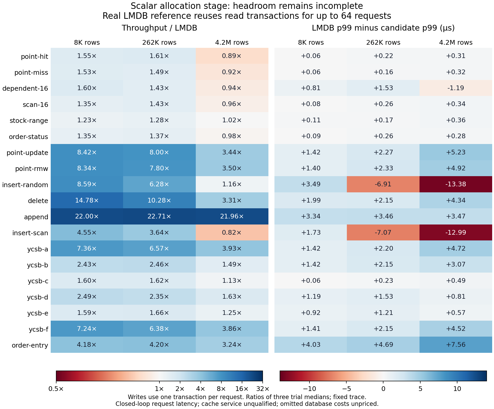
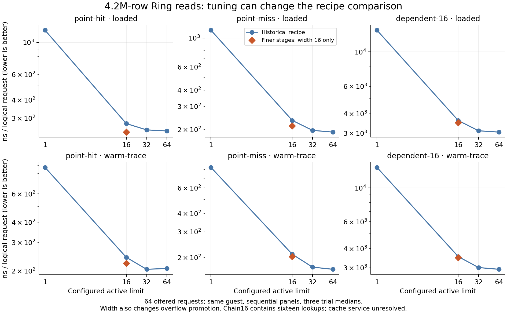

# Allocation-stage headroom, read width and residency

This is the frozen comparison before the bounded common-source integration on
2026-10-07. It retains the failed headroom cases as well as useful wins. The
current integrated implementation needs its own validation and measurements;
these results do not qualify it.

## Scalar requests

The common source ran all 19 scenarios at 8,192, 262,144 and 4,194,304 rows,
with three trials, separate throughput/request-latency intervals and five
backends: 1,710 validated runs. Each request outcome and final ordered state
matched the independent map. The plot selects the primary synchronous
`packed-owner` path against real `lmdb-read-batch64`. That reference keeps a
read transaction for up to 64 adjacent reads, closes it before writes, and
uses one actual transaction per write request.



At 4.2M rows, point hits/misses, dependent chains, scans and status reads have
throughput ratios below one. Dependent-chain p50/p99 also lose. Random inserts
and mixed insertion/scans have roughly 13 µs worse p99 despite better median
latency; mixed insertion/scans also lose throughput. Append, deletion and
order-entry show substantial wins. There is no universal stage win, and these
ratios leave future database costs unpriced: Engine, Shore, versioning,
concurrent isolation and durability are absent from the candidate.

The retained comparison contains all candidates/references, p50 and p99.
Ratios use median trial values; fixed-seed timing repetition does not sample
trace diversity. Request latency is closed-loop service time for one assigned
caller, with no arrival queue. Timer overhead is retained, not subtracted.
Nine separate finite/window/mixed lifecycle runs all ended with zero charge;
their small footprints did not test arena-budget exhaustion.

## Read recipe and active width

The historical six-stage recipe has active limits 1/16/32/64; the finer-stage
common recipe has only width 16 measured here. Both offer batches of 64 and
use native direct, manual interleaving and real Loom Ring execution, under
`loaded` and `warm-trace` histories at the same three row counts/trials.
There are 1,944 historical runs and 486 finer-stage runs, sequentially on the
same guest. All 162 width-16 groups match source-pair input, trace, outcome,
final state, useful work and completion identities.



At equal width 16, the finer recipe improves large Ring throughput by about
2–15%, depending on case/history. The historical recipe at width 32 or 64
can tie or beat the finer recipe at 16. The finer recipe's best width remains
unmeasured, so this is not a tuned recipe ranking. Reference timings vary
between sequential panels; small differences need a joint comparison.

Width also changes Ring overflow promotion (63/48/32/0 requests at active
1/16/32/64), not just overlapping memory requests. Native and LMDB execute
serially even where a configured active limit is recorded. Throughput divides
elapsed time by logical requests. A dependent-chain request contains sixteen
lookups. No batch makespan is presented as individual request p50/p99.

`loaded` means a freshly loaded, validated representation; `warm-trace` adds
an untimed replay of the exact read trace. Neither guarantees DRAM service.

## PMU and residency limits

The small Graviton 4 guest's real-memory chase ran 360 intervals over
16 KiB/512 KiB/8 MiB/256 MiB and 1–64 independent chains. Cycles, instructions
and generic L1 misses had full group coverage. The L1 signal responds to the
footprint sweep. All six attempts at architectural L1/L2/L3 refill events—raw
type 4 and the actual sysfs PMU type 10—failed with `EINVAL`, including
advertised aliases. Successful generic counters do not establish permission
for those raw events, or identify the source of a refill.

The separate composed Graviton diagnostic retains 162 validated runs, their
actual caller-thread PMU receipts and post-interval mapping summaries. For
large loaded point hits, manual/Ring execution lowers elapsed ns/request and
generic L1 events/request while executing more instructions. Higher IPC alone
does not rank performance. This is one trial with PMU enabled, not a cross-ISA
performance comparison or an LLC/DRAM classification. Supported composed
frontend-stall observation remains pending; these intervals use basic counters.

The earlier [memory controls](../prefetch-control-20261007/README.md) retain the
Zen 5 generic L1 counter's flat zero across an above-cache chase: that signal
is unqualified. Mapping summaries union overlapping representation extents;
they are not accessed-line sets. Original address lists and kernel mapping
files are recoverable. [Residency tools](../../../../tools/residency.md) cover
conditioning, page policy, counter qualification and their limits.

## Inputs and regeneration

[Cohorts](cohorts.json) record jobs, source digests, guests and full-archive
hashes. Each selected bundle has `artifact.json` for recovery and
`provenance.json` for its retained bytes. JSONL entries preserve original
paths/hashes, parsed JSON or CSV columns with string-valued rows. Bulky
mapping address lists are explicitly derived extent/kind summaries; the
byte-identical originals stay in S3. Scalar/width per-case result files and
request samples also stay in those full archives.

The selection keeps the complete all-case summaries, complete width/history
controls, real-memory event qualification, and actual composed counter
receipts. It omits build logs, binaries and successful-check transcripts from
Git. The two diagrams and [summary](summary.json) regenerate from retained
inputs alone, with Python, NumPy and Matplotlib:

```sh
python3 workbench/benchmarks/orbital/evidence/allocation-residency-20261007/plot.py \
  --output build/reports/orbital-allocation-residency
```

To recover original per-request samples or address lists, use
[artifact recovery](../../../../tools/artifacts.md) with the corresponding
bundle's reference and original `source_file` path. Measurements stay
immutable while source integration continues.

## Recover archive-only inputs

Git retains findings, selected comparisons and context. Raw intervals, duplicated
JSON tables, full manifests and SVG companions are in the
[verified pre-curation archive](../20261008-before-curation-artifact.json);
[the curation record](../20261008-curation.json) names every removed file and hash.
Full worker archives remain referenced separately for original samples, sources
and binaries. Recover into ignored storage:

```sh
orb -m ubuntu python3 workbench/tools/artifacts.py fetch \
  workbench/benchmarks/orbital/evidence/20261008-before-curation-artifact.json \
  build/recovered/orbital-evidence-20261008
```

Regenerate from that recovered selection:

```sh
orb -m ubuntu python3 workbench/benchmarks/orbital/evidence/allocation-residency-20261007/plot.py \
  --inputs build/recovered/orbital-evidence-20261008/allocation-residency-20261007 \
  --output build/reports/allocation-residency-20261007
```
