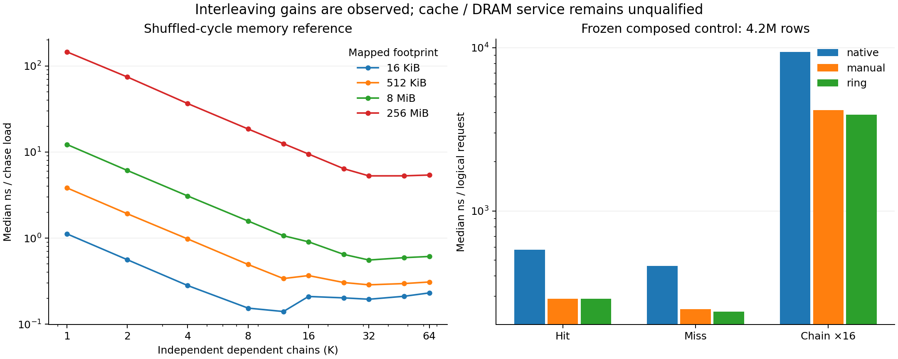

# Frozen prefetch control and memory reference

This selected record joins three complete, same-guest composed execution arms
with an independent memory sensitivity control. It preserves the point-in-time
comparison rather than assigning its requests to a cache or DRAM service tier.
The newer Page frontier and common runtime cleanups are absent from this frozen
source; they need their own matched comparison.



The composed control offers 64 requests at a time with 16 active staged lanes.
At 4,194,304 initial rows, Ring/native throughput factors are about 2.00 for hits,
1.90 for misses and 2.43 for 16-link chains. Ring/manual factors are about 1.00,
1.04 and 1.07. These homogeneous traces do not establish equality for uneven
request lengths, refill behavior or other workloads. Native/manual/Ring arms
ran sequentially on one c8a.xlarge guest with the same binary, inputs, traces and
final states. The raw retained tables include actual LMDB references, all three
footprints, throughput runs and separately labeled whole-batch latency samples.

The memory reference initializes and validates shuffled encoded cycles, warms
1,024 steps and calibrates before each timed chase. Actual mappings are 4 KiB,
without THP, on NUMA node 0. A 256 MiB footprint takes about 146 ns per load at
K=1 and 5.29 ns per load at K=32. This shows a concurrency response in that
reference. A chase load is not a composed logical request, and the suites have
different access histories. Neither suite flushes or evicts its data.

**The generic L1D miss counter is unqualified on this guest.** It opens and has
full measurement coverage, but reports zero in all 360 real-memory intervals,
including the 256 MiB chase. Cycles/instructions are collected; cache/DRAM load
source is unknown. The host reports a 16 MiB shared LLC; footprint alone does not
establish where measured loads were served. See the
[residency guide](../../../../tools/residency.md) for setup and qualification.

`plot.py` checks retained-input hashes, three-trial completeness and composed
identities before regenerating `summary.json`, PNG and SVG (Python + matplotlib).
The summary gives all plotted medians and units. Each retained bundle's
`artifact.json` references recoverable full outputs; binaries and bulk logs are
kept there instead of copied into this selected record.

Each memory control keeps its 360 raw interval records in one `intervals.jsonl`,
with original file names and byte hashes. Consolidation preserves every parsed
record; the byte-exact original sidecars remain in the recoverable full bundle.

The [Graviton memory sensitivity control](graviton-memory-reference/memory-pmu/pmu-analysis.json)
uses the same 40 footprint/concurrency cells and nine intervals per cell on a
separate c8g.medium guest. All 360 groups have full coverage. Its generic L1
event responds: at K=1, median event counts per chase load are about 0.0002 for
16 KiB, 0.96 for 512 KiB and 1.00 for 256 MiB. This qualifies its responsiveness
to the memory control, while CPU/kernel event semantics still need verification.
It does not identify the source of a refill or establish composed-workload
performance across architectures. Actual mappings again show 4 KiB, no THP and
NUMA node 0; the host reports a 36 MiB LLC.

## Recover archive-only inputs

Git retains findings, selected comparisons and context. Raw intervals, duplicated
JSON tables, full manifests and SVG companions are in the
[verified pre-curation archive](../20261008-before-curation-artifact.json);
[the curation record](../20261008-curation.json) names every removed file and hash.
Full worker archives remain referenced separately for original samples, sources
and binaries. Recover into ignored storage:

```sh
orb -m ubuntu python3 workbench/tools/artifacts.py fetch \
  workbench/benchmarks/orbital/evidence/20261008-before-curation-artifact.json \
  build/recovered/orbital-evidence-20261008
```

Regenerate from that recovered selection:

```sh
orb -m ubuntu python3 workbench/benchmarks/orbital/evidence/prefetch-control-20261007/plot.py \
  --inputs build/recovered/orbital-evidence-20261008/prefetch-control-20261007 \
  --output build/reports/prefetch-control-20261007
```
