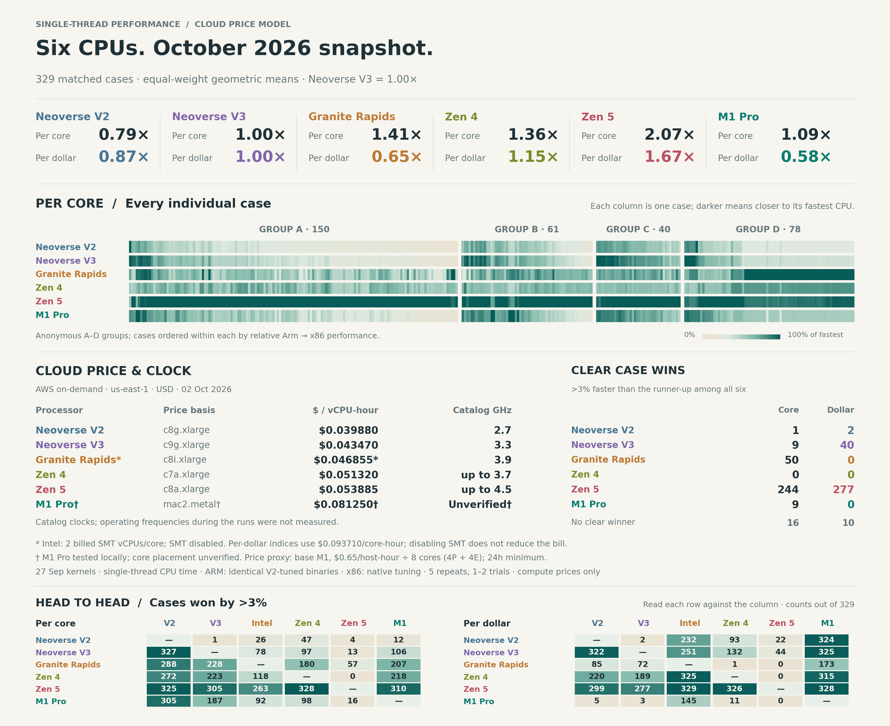

# Ikea CPU comparison: October 2026 snapshot

How did the same Ikea workloads compare across six processor/platform targets?
This completed snapshot retains **329 matched cases and 16,450 repetitions**
from September 27–October 2, 2026. It measures the September 27 original kernels,
before the subsequent Bec256 pair scheduling and V3-only TuplePack dispatch
changes in the [Neoverse investigation](../ikea-neoverse-v3/README.md).
It is a historical comparison, not current production performance.



The [SVG](figures/comparison.svg) and PNG are the single selected layout, with
listed vCPU prices and catalog clocks beside the case wins. The figure, its
[anonymous numeric input](evidence/2026-10-02/plot-data.json) and
[catalog clock annotations](catalog-clocks.json) remain suitable for sharing.
This account and the named evidence are private project material.

## Surviving findings

Indices are equal-weight geometric means of per-case speed relative to Neoverse
V3 = 1. Each speed is V3 median CPU ns divided by candidate median CPU ns.
The price column divides that speed by allocated hourly core cost, also relative
to V3. It is a model using the October 2 price capture, not measured fleet throughput.

| Processor / measured platform | Single-thread index | Allocated-price index | Clear fastest cases |
| --- | ---: | ---: | ---: |
| Neoverse V2 / C8g | 0.794 | 0.865 | 1 |
| Neoverse V3 / C9g | 1.000 | 1.000 | 9 |
| Granite Rapids / C8i, SMT disabled | 1.410 | 0.654 | 50 |
| Zen 4 / C7a | 1.360 | 1.152 | 0 |
| Zen 5 / C8a | 2.066 | 1.667 | 244 |
| M1 Pro / local OrbStack | 1.089 | 0.583 (rental proxy) | 9 |

Sixteen cases have no clear fastest processor. A clear win means more than 3%
ahead of the runner-up among all six; this threshold is descriptive, not a
statistical significance test. Zen 5 leads the aggregate and beats Zen 4 by
more than 3% in 328/329 cases. M1 versus V3 is mixed: 187 M1 wins, 106 V3 wins
and 36 within the reciprocal 3% band.

The workload split is more useful than a universal ranking:

| Figure group / actual suite | Cases | V2 | V3 | Granite Rapids | Zen 4 | Zen 5 | M1 Pro |
| --- | ---: | ---: | ---: | ---: | ---: | ---: | ---: |
| A / SeriesPack | 150 | 0.772 | 1.000 | 1.495 | 1.621 | 2.618 | 1.097 |
| B / TuplePack routine | 61 | 0.807 | 1.000 | 1.186 | 1.095 | 1.702 | 1.020 |
| C / TuplePack words | 40 | 0.797 | 1.000 | 0.904 | 0.789 | 1.282 | 0.931 |
| D / Bec256 | 78 | 0.825 | 1.000 | 1.810 | 1.518 | 1.948 | 1.224 |

These are single-thread indices. Zen 4 leads V3 overall, while V3 leads Zen 4
per allocated dollar in TuplePack routine and words. Granite Rapids leads V3
overall per thread but trails it in the word group. These observations keep
generation, workload and billing allocation visible in any Arm/x86 comparison.

The retained case identities also reveal much larger differences within a suite:
Zen 5 is 21.86× V3 for SeriesPack `ordinary/k7/local/read/concrete`, but 0.576×
for `ordinary/k64/local/point/bound`. For Bec256 it is 2.78× for
`codec/terminal/prepare_write` and 0.838× for `codec/random/enum_bits`.
These are useful old controls when investigating those operations; they do not
attribute the difference to hardware alone or establish a remaining kernel defect.

## Measurement and limits

- All targets use the same historical C++ source capture, SHA-256
  `1b32418a5ee879491f45ab93a0d7e5151c6098a6237f879ed22441f664f5e747`,
  associated with commit `03f015217072aa6f31cfaf95f911adeb8a988848`.
  ARM runs identical Clang 21.1.8 binaries with `armv8.2-a+simd` and V2 tuning;
  x86 builds use native `znver4`, `znver5` or `graniterapids` ISA/tuning. Zen 4
  adds a recorded CMake tuning overlay without changing the C++ kernels.
- One pinned thread, sequential cases, five repetitions per case and a minimum
  0.05 CPU seconds. V2/V3 have one historical process trial; other targets have
  two trials with reversed suite order. Case medians use the median of trial
  medians. Four behavior checks passed on each newly measured target. Fifteen
  x86-only SeriesPack cases are excluded; selected logical counters match.
- The two-trial median changes are +0.01% Intel, −0.02% Zen 4, +0.05% Zen 5
  and −0.58% M1. Their 90th-percentile absolute changes are 1.71%, 2.03%, 1.86%
  and 2.52%; 9, 15, 12 and 12 cases change more than 5%. This describes local
  repeatability, not between-instance or between-day uncertainty. Figure
  percentiles describe the spread across workloads, not confidence intervals.
- Resident microbenchmarks omit database workload weighting, cold-memory
  behavior, host scaling and energy. Every case has equal aggregate weight,
  so SeriesPack contributes 150/329 cases. Runtime libraries/platforms and
  architecture-specific implementations differ. OrbStack pins a virtual CPU;
  physical M1 performance-core placement and clocks were not verified.

## Frozen price model

AWS Price List API captures for Linux/shared/on-demand US East (N. Virginia),
October 2, 2026. Selected products and effective dates remain in
[measurement context](evidence/2026-10-02/measurement-context.json).
The following values are historical inputs, not a refreshed price quotation.
The clock annotations copy this same capture's `clockSpeed` labels and are
checked against it by the report. They preserve the AMD "up to" qualifiers;
they are not measured operating frequencies or an IPC normalization. The
figure marks the measured local M1 Pro clock as unverified: the catalog's
3.2 GHz describes the unmeasured base-M1 rental instead.

| Price product | USD/host-hour | Allocated cores | USD/allocated-core-hour |
| --- | ---: | ---: | ---: |
| c8g.xlarge | 0.15952 | 4 | 0.03988 |
| c9g.xlarge | 0.17388 | 4 | 0.04347 |
| c8i.xlarge | 0.18742 | 2 | 0.09371 |
| c7a.xlarge | 0.20528 | 4 | 0.05132 |
| c8a.xlarge | 0.21554 | 4 | 0.053885 |
| mac2 Dedicated Host proxy | 0.65 | 8 listed cores | 0.08125 |

Intel has two billed SMT vCPUs per measured physical core; disabling SMT does
not reduce the instance charge. The Mac rental is base M1 with four performance
and four efficiency cores, while measurements are local M1 Pro. Applying those
timings to that rental is an unmeasured proxy. The Mac figure allocates cost
across eight listed cores; the retained four-performance-core alternative gives
index 0.291. Neither measures base-M1 performance or multicore scaling.
The captured model assumes sustained allocations, notes the Mac 24-hour minimum,
and excludes discounts, storage, network and tax.

## Evidence, reproduction and retirement

[Cases](evidence/2026-10-02/cases.csv) retain exact identities, six CPU medians
and the separate trial medians. [Iterations](evidence/2026-10-02/iterations.csv)
retain every selected repetition and logical counter. The measurement summary
and context retain original bytes; the compact export's provenance hashes the
selected inputs and records an offline report recipe.

From macOS, prefix Linux commands with `orb -m ubuntu`. No benchmark binaries,
AWS requests or worker launches are needed to check the retained comparison:

```sh
python3 workbench/spikes/ikea-cpu-comparison/report.py \
  workbench/spikes/ikea-cpu-comparison/evidence/2026-10-02 \
  --output build/reports/ikea-cpu-comparison
```

This independently rebuilds medians, logical-counter agreement, aggregates,
group/case distributions, captured price allocation and strict 3% wins, then
checks them against the selected snapshot. Add `--plot` to render the selected
PNG/SVG; plotting needs Matplotlib (validated with 3.10.8). The same recipe is
available through `workbench/tools/artifacts.py report`; invoke it using a
Python environment with Matplotlib. Rendering may vary with fonts/dependencies.

Full cloud results, binaries and source captures are recoverable with
`artifacts.py fetch` using the adjacent `c8g-artifact.json`, `c9g-artifact.json`,
`granite-rapids-artifact.json`, `zen4-artifact.json` or `zen5-artifact.json`.
For example:

```sh
python3 workbench/tools/artifacts.py fetch \
  workbench/spikes/ikea-cpu-comparison/evidence/2026-10-02/zen4-artifact.json \
  build/recovered/ikea-cpu-comparison-zen4
```

The former `ikea-m1-v3/` is retired. Its two-/five-CPU duplicates, alternate
layouts and measurement/price launchers add no independent comparison value.
The complete original study, full local M1 raw run and price captures were
archived and download-verified before removal. Recover them with:

```sh
python3 workbench/tools/artifacts.py fetch \
  workbench/spikes/ikea-cpu-comparison/evidence/2026-10-02/original-study-artifact.json \
  build/recovered/ikea-cpu-comparison-original
```

The recovery layout is `study/` (all 51 original non-cache files),
`local-m1-run/`, `pricing-inputs/` and `original-study-sha256.json`.
The separate Neoverse study owns specialization findings and maintained source
changes. A fresh performance claim requires a fresh source-matched campaign;
this snapshot remains an old comparison and a source of case-level controls.
