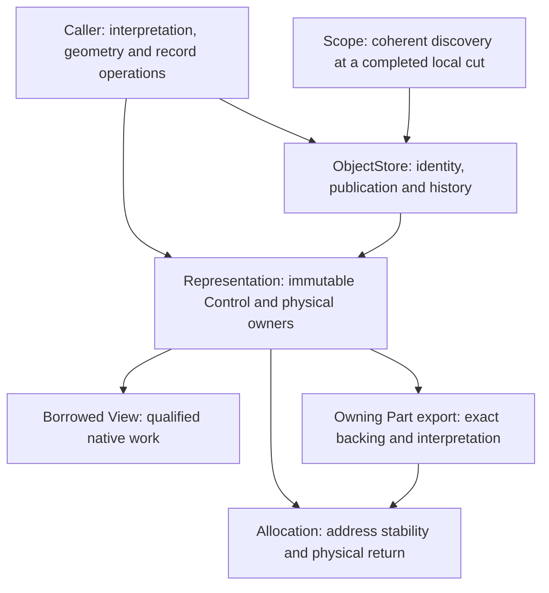

# Orbital Stage 2 outcomes and handover

10 October 2026. The embedded single-owner Objects/Representations/Views
implementation is present, exercised and consolidated. The useful result is a
small set of ownership boundaries supported by real codec callers, plus evidence
showing where those callers spend work. It is not a database implementation or a
claim of broad LMDB parity.

Ashton has dropped Stage 3 from the plan. Ikea and Engine come next; future
Orbital development will follow their actual composition requirements. Worker
collaboration, I/O and distributed protocol questions remain relevant but are
not a scheduled implementation phase. Engine navigation, membership, indexes,
summaries, schema policy and multi-block containers remain open for his design.

## What is implemented and demonstrated

The [module guide](../../../orbital/README.md#embedded-objects) owns the current
contracts. Normal module tests use an independent integer material and physical
ownership fixtures; selected-catalog and real-format checks add these histories:

- A Scope preserves coherent later discovery and absence across publication,
  suspension and catalog-handle teardown. A short Borrowed read is available
  only within one uninterrupted owner operation.
- Finished private owners are prepared against a current basis, then a whole
  batch installs at one local cut without allocation or disposal callbacks.
  Refusal and abort leave published state intact; cleanup handles disposal reentry.
- Conversion changes one Tuple Part into four Series Parts and back at the same
  logical version. Old counts, interpretation and bytes remain valid; replacement
  of an alternative does not redirect an existing selection or sealed export.
- An exported Part can outlive its Scope and catalog handle. Independent physical
  owners can release sibling bodies; grouped backing retains its whole allocation,
  and shared interpretation can retain the full directory. Its required owners
  remain alive until release. Shared capture permits authorized disjoint writes
  only with stable
  backing and preservation of the complete captured body/padding footprint.
- Nine bounded-maintenance histories now run against production `ObjectStore`,
  including interrupted plans, reader changes, accepted pins, refusal, recycling,
  disposal callbacks and interleaved reads/writes. Their independent value and
  absence assertions were reused unchanged from the controls.
- The actual [Loom caller](callers/object_module.md) covers direct ready work,
  suspension, cancellation and a foreign immutable read whose retained completion
  returns release to the owner Lane. It does not make the catalog concurrent.

Native checks and focused ASan/UBSan, use-after-return and leak checks support
these stated histories. They are not an exhaustive proof, a new full-platform
sanitizer matrix, or qualification of consensus and durable recovery. No known
unresolved embedded correctness blocker emerged from consolidation.

## What the performance and memory evidence shows

Each row below belongs to its own captured source and workload. These results
cannot be assembled into a single final-build speedup or headroom budget.

| Result | Evidence and practical limit |
| --- | --- |
| Short coherent native paths are viable | [Friend fusion](performance/FEEDBACK.md#coherent-read-fusion) and [canonical selected reads](performance/FEEDBACK.md#canonical-selected-read-specialization) reduce repeated selection/interpretation work. In the latter large batch cases, Inline point reads are 77.18 ns versus mapped LMDB 76.89 ns; dependent16 is 1083.19 versus 1078.57 ns. Tiny cases can lead substantially, while other reads/writes still lose. The mapped comparator receives the same codec improvements and verified reset/renew lifecycle. |
| Independent work gives a much larger opportunity than narrow call tuning | At 193 MB of Tuple bodies, [hinted Ring32](performance/FEEDBACK.md#wider-request-interleaving-and-append-growth) takes 1.455 µs per dependent16 request versus matched direct 7.355 µs. Ring1 takes 19–20 µs and loses badly. Two observations, synthetic access, no LMDB arm or hardware IPC/DRAM proof. |
| Append copy grain dominates this fixture | A 65,536-row prefix followed by 513 scalar appends copies 776,279,808 B. Batch64 reduces that to 13,618,944 B. The [bounded shared-prefix control](performance/FEEDBACK.md#bounded-shared-prefix-append-alternative) removes prefix copies and runs about 42.6× faster than its matched fresh-copy arm. It bundles several caller changes and assumes an explicit 2 MiB reservation; no rollover or general update policy follows. |
| Native work can return to service completions economically | The [finite ready-Message comparison](performance/FEEDBACK.md#ready-message-service-during-large-dependent-reads) keeps loaded Ring128 throughput within 0.3–0.9% of unloaded observations. Message p50 is about 4.2 µs versus 1.5 ms when service waits for the read group. Quantum32 lowers delay but costs 11–16% throughput. 99.63% of loaded128 polls are empty: this is not sustained arrival capacity or a request-tail guarantee. |
| Metadata is substantially more explicit and compact, but the whole collection is still sizeable | Current history nodes are 16 B plus separate 8 B physical-directory slots; current entries are 40 B. Scope is 32 B, stationary Prepared 48 B and Selection/View 8 B; the driver's concrete owning Part export is 80 B. [The current initial census](metadata/composed/README.md#initial-collection-inventory) is 24,102 B Tuple / 27,843 B Series for 64 Objects × three rows on AArch64/4 KiB pages. This includes shared Schema, caller and setup state; it excludes payload, transient frames, libc rounding and OS/thread overhead. |
| Smaller state does not automatically improve the complete operation | Rebuilding Schema per call saved 13,176 resident bytes on the measured x86 build but made tiny Tuple construction roughly 9× slower. [Diagnostics removal](performance/FEEDBACK.md#removing-diagnostics-rejected-complete-operation-tradeoff) regressed batches; [masked maintenance](performance/FEEDBACK.md#masked-maintenance-retained-reader-gain-fresh-reader-regression) helped long readers but hurt fresh-reader scalar work. These remain negative or unselected evidence. |

The earlier 4–8 KiB collection aspiration is not met. The current AArch64
Schema contributes 10,176 B alone. [Exact heap control backing](metadata/orbital/allocation/heap-control/README.md)
reduces requested allocator metadata and simplifies cleanup; its mixed local
timings do not establish an RSS or universal speed improvement. The current
census is a pre-operation counter snapshot, not another timing campaign.

Allocation was revisited as part of the same design: finite identities now use
four-byte physical-use records plus one-byte bindings, with lifetime and advice
shared at Group level. The [route comparison](performance/FEEDBACK.md#allocation-advice-and-direct-slots)
and [allocation notes](metadata/orbital/allocation/README.md) preserve the costs
and limits. Coarser advice, checked use-count limits and owner-local geometry are
real tradeoffs; removing per-allocation state did not prove better cache policy
or foreign-thread scalability.

We have not established broad LMDB parity, realistic mixed-transaction behavior,
skewed locality, sustained pressure/backlog stability, request-level Ring tails,
or headroom for Engine/Shore and future I/O. The larger surveys exposed useful
opportunities; they did not measure those missing compositions. Static assembly
and LLVM-MCA evidence helped explain candidates, but deep IPC gains, FP/SIMD
pipeline mixing and cache-service attribution were not demonstrated in hardware.
The matched encoded-body comparator isolates foundational overhead. Real
navigation, positioned scans, insertion/split repair and index maintenance will
need comparison again when Engine supplies them; a fast fixed blob lookup does
not settle those earlier LMDB gaps.

## Lessons for Ikea, Engine and schema work

These are constraints and experimental leads, not a container or Engine design.

1. **Choose ownership and interpretation lifetimes separately.** A small borrow
   is useful because ownership is already established elsewhere. Shared immutable
   geometry/laws can serve many realizations, while each retains its own actual
   count and backing. A [same-extent Series count change](metadata/composed/README.md#driver-integration)
   shows why byte extent cannot authenticate logical count. Equal format/count
   also cannot prove converted content equivalence.
2. **Amortize invariant preparation at the lifetime that has actual reuse.**
   [Shared writer laws](metadata/consumer/shape-write.md) and
   [canonical reads](metadata/consumer/shape-read.md) remove repeated plan work;
   fresh placement still needs admission. The [Schema negative](performance/FEEDBACK.md#transient-schema-construction-phase)
   argues for measuring construction-plan reuse, not universally keeping or
   rebuilding every plan. The fixture has no schema evolution or interning policy.
3. **Express the useful operation narrowly.** The [value/tag command](metadata/consumer/point-write.md)
   preserves cloned key/next fields, removes a source lookup and issues fewer
   stores. Its scalar negatives and clone-first refusal precedence remain relevant.
   Container semantics, effects and index/summary dependencies must determine the
   real command; the fixture's four fields do not define that interface.
4. **Design copy and publication grain together.** The append results show how
   batch size and stable disjoint suffix construction can dwarf metadata savings.
   They do not select a split policy, reserve predictor, chunk size or shared-write
   protocol. Count, readable padding and preserving stores determine whether an
   ostensibly separate logical suffix is physically disjoint.
5. **Price conversion through its useful lifetime.** Account for source and target
   overlap, retained alternatives, subsequent work and eventual trimming. The
   [identity census](performance/controls/conversion-capacity/README.md) explains
   245,760 B of slack when a retired Tuple window backs one smaller column. It was
   the only idle candidate: a better-fit search cannot fix that case. Fresh backing
   buys a tighter capacity at the cost of mapping/preparation and possible refusal.
6. **Separate logical retention, reclaim service and physical memory.** Exact
   active cuts avoid retaining every intermediate version, but long readers still
   affect work. A bounded drain needs enough service, not merely a small budget.
   [Horizon repair](metadata/orbital/candidates/controls/horizon-refresh/README.md)
   fixed one conservative-retention problem without fixing service insufficiency.
   Ending a Scope does not trim idle mappings or return allocator arenas to the OS.
7. **Expose independent chains without forcing every operation through them.**
   Keep direct ready work cheap. Stable operation frames can retain coherent state
   while small recurrent state is interleaved. Ring widths, hints and service
   quanta need the real work mix; independent per-request Scopes do not demonstrate
   parallel execution of one transaction.
8. **Keep measurements inside the design loop.** The withdrawn implementation
   showed why post-hoc optimization is insufficient. Charge caller state, setup,
   retained/idle capacity, copying, release and generated code as well as latency.
   Small ordinary ABI packets and deliberate friend fusion help, but a smaller
   record, frame or instruction listing is not itself a performance result.

## What carries into later composition

| Area | Reusable result | Still open |
| --- | --- | --- |
| Engine and containers | Coherent discovery/absence, atomic multi-Object publication, exact-version conversion, explicit interpretation lifetime, refused private work and bounded-maintenance histories | Navigation, membership, split/merge, indexes/summaries, schema evolution, semantic dependencies and actual mutation/copy grain. One accepted Prepared excludes other publication and requires the current global basis; this is a conservative embedded mechanism. A fresh Scope cannot validate computation from old inputs. |
| Collaborating workers | Stable retained operation state; foreign immutable bytes with owner-Lane completion; physical return independent of cancellation; explicit service boundaries | Concurrent catalog access, parallel transaction coordination, placement/migration, contention, reclamation and progress under sustained competing work. Owner-local PMR and catalog lifetimes cannot simply be passed to another worker. |
| I/O and recovery | Captured identity/interpretation, address stability, completion versus receipt versus physical retirement; capacity charged until real release | Missing-byte reconstruction, Port submission/backpressure, durable admission, replay and distributed authority. Local cuts are not Epoch or SerialPosition. Holding a Prepared reservation across I/O would prevent other publication; a finished Owner can wait before acceptance, with its dependencies still validated. |
| Shore | Exact retained Part export and explicit outcomes provide useful examples for adapters; cancellation does not undo accepted publication or free in-flight backing | External protocol/format contracts, streaming, error/result mapping, partial progress and end-to-end CPU/copy/backpressure costs. No Shore integration was measured. |

The wider [Orbital specifications](../../../orbital/spec/README.md) retain
distributed/versioning obligations. This implementation does not settle their
mechanisms. In particular, physical equivalence supplies no logical publication,
durability or recovery authority.

## The test driver is disposable

The [composed guide](metadata/composed/README.md) describes calls, lifetimes,
accounting and checks. Its [assumptions](metadata/composed/README.md#disposable-assumptions)
are collected explicitly so they are not inherited accidentally. The important
limits include a fixed four-field schema, sorted fixed records, whole-Part clone
updates, primary-read/alternative-write preference, 64-command scratch, one-Object
Tuple append and fixed Ring frame banks. `changes = 1` means one accepted offered
command, including repeats and same-value stores; it is not SQL affected-row
semantics. The fixture's Schema is an executable codec control, not an Engine catalog.

When replacing it, preserve the consequence histories and independent oracles:
late absence, old interpretation/count, atomic refusal, exact alternative export,
partial codec failure, cancellation/late completion, physical settlement and
maintenance interrupted by readers/publication. Rebuild their setup around the
real containers. Preserve measured source captures for comparisons; their APIs
and the temporary harness do not need to survive as production interfaces.

## Navigation, curation and the remaining spring clean

| To understand or change… | Start here |
| --- | --- |
| Public semantics and the smallest material example | [Orbital guide](../../../orbital/README.md#embedded-objects), [object.h](../../../orbital/include/orbital/object.h), [test material](../../../orbital/test/object_material.h), [its instantiation TU](../../../orbital/test/object_material.cpp) |
| Logical publication and retention | [store_impl.h](../../../orbital/src/object/store_impl.h), [history_impl.h](../../../orbital/src/object/history_impl.h); shared cold allocation in [storage.cpp](../../../orbital/src/object/storage.cpp) |
| Physical capture and escape | [representation.h](../../../orbital/include/orbital/representation.h), [representation_impl.h](../../../orbital/src/object/representation_impl.h), [normal consequence tests](../../../orbital/test/representation.cpp) |
| Actual format/caller composition | [Material and Backend guide](metadata/composed/README.md), [Shape](metadata/orbital/shape/README.md), [caller-owned fusion](metadata/composed/read_fusion.cpp), [Loom caller](callers/object_module.md), [Ring caller](callers/object_ring.md) |
| A measured decision or rejected alternative | This report → [performance entry](performance/README.md) → the relevant [feedback section](performance/FEEDBACK.md) → source recipe, compact tables and artifact reference beside that run |
| Unselected follow-ups | [Parked controls](performance/controls/parked-followups/README.md), [prepare-pass lead](metadata/orbital/candidates/controls/prepare-pass/README.md) and the performance entry's workload questions; none is queued |
| Earlier designs and their limitations | [Study entry](README.md), [earlier composition](../orbital-stage2-composition/README.md), [selected-access prototype](../orbital-selected-access/README.md); these are not current module interfaces |

The selected code is organized around a few ideas with clear owners. Cold
operations compile separately; reads expose only the structures needed for the
ordinary path and measured private fusion. That visibility and friend coupling
are deliberate maintenance costs. The concrete catalog TU is shared by the
composed and Loom callers. No new dead production source or runtime redesign
blocker was found in the final navigation review.

The study is harder to navigate: it contains over a thousand tracked files,
mostly compact evidence/receipts, and a long chronological feedback log. This
handover supplies the missing decision-oriented route. Selected, rejected,
historical and untimed work are distinguished; older sources remain because
current comparison and consequence checks still depend on parts of that machinery.
Bulk deletion now would be a separate dependency migration, not a spring clean.

The bounded cleanup for this handover fixes stale current-state/capture prose,
Body-borrow terminology, repeated compilation, the final initial census, downstream
links and private-only follow-up recovery. Existing runs retain their original
bytes and limits; notably, the cooperative-service run retained executable hashes
but did not export its ELFs. Its source and samples are recoverable, and the runner
now exports executables after clocks. No reproduction claim repairs that old gap.
Two [early consumer codegen captures](metadata/consumer/evidence/early-codegen-20261009/README.md)
also retain their analyses and compiler receipts, but not a shared archive of all
candidate overlays and full outputs. Their exact replay still depends on local
captures. Those historical limits are explicit; later selected-source evidence
must be used for current implementation claims.

Preparation still uses pairwise duplicate validation and repeated directory
lookups; the current driver's small packets do not qualify larger publication
scales. The [preparation lead](metadata/orbital/candidates/controls/prepare-pass/README.md)
records these concrete costs and the refusal/rollback tradeoffs in changing them.

After this pass, further preparation lookup/duplicate-scan work, retention-policy
changes, conversion selection and caller memory reductions belong with an actual
workload. No broad experimental-tree rewrite or new benchmark campaign is needed
to leave Orbital for Ikea/Engine. On return, use the real caller to decide which
remaining controls are worth reviving and which fixture machinery can retire.
