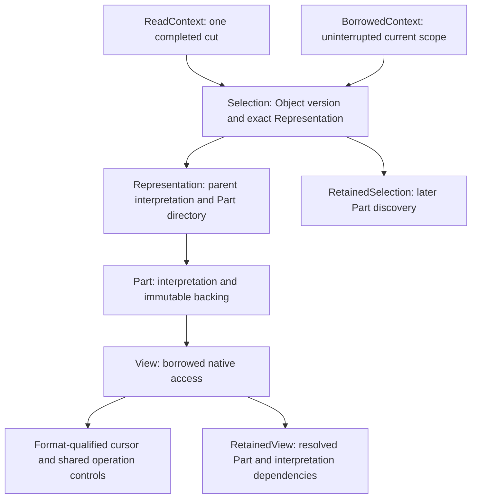
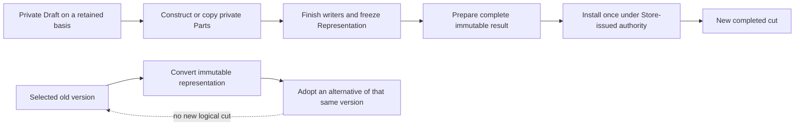

# Rejected baseline structure

Three ideas organize the baseline access path: a coherent logical selection,
a complete physical interpretation, and access to its immutable backing.
The [public header](https://github.com/ashtonsix/SixDB/blob/c8f9081104ef61ee897fbbaf954223ae0a3d7656/workbench/spikes/orbital-mvcc/baseline/include/orbital/mvcc_baseline.h) owns exact signatures
and lifetime rules.

A borrowed current context needs no reader enrollment, Task, Buffer or Hold.
Its scope ends before publication, suspension or other invalidating owner work.
A retained ReadContext protects later discovery across Objects and Parts even
when all currently open Views have closed. Once that discovery is finished,
resolved retention can keep the needed Part and interpretation dependencies
without preserving a whole catalog snapshot. A caller-supplied umbrella owner
can still pin several Parts; physical ownership determines that granularity.

A Representation includes parent interpretation as well as each Part's bytes
and interpretation. Format metadata and any decoder dependencies survive with
the bytes. Object identity/version and opaque logical metadata describe logical
state; Replica/format and Part geometry describe physical form. A Part ID alone
cannot qualify an access across Representation changes.

Private construction may be discarded. Preparation is the embedded owner's
acceptance point: resource refusal leaves the Draft usable; success consumes it
and issues a Store-bound, single-use Prepared result. Installation validates its
basis and publishes the changed Objects together. Aborting an accepted result,
including destroying it uninstalled, is an explicit no-effect terminal outcome
in this profile. This is finished-result acceptance, not a stored-input/replay
promise. A public version number or copied bytes supply no publication authority.

Physical conversion does not advance the logical cut. The owner establishes
semantic equivalence; Orbital checks identity/version and logical metadata.
Later explicit alternative selection can use the converted descriptor. Retained
selections and selections protected by a ReadContext keep their original binding;
an alternative borrowed from the current context ends before its replacement.
The temporary consumer converts
four SeriesPack column Parts into one TuplePack row Part and back.

The catalog owns stable Object entries and immutable version histories. Preparing
changes does not copy the entire Object directory. Retained contexts constrain
history pruning; explicit draining separates reclamation from final installation.
Metadata is separately bounded and reported; captured owners and Allocation
backing have their own accounting. Drain's work bound is not a latency guarantee:
opaque owner destructors can take arbitrary time. These are single-Lane ownership
rules; they do not implement Stage 3 reclamation.

Ikea qualifies formats and supplies native bodies. Loom keeps the selected
context and interpretation in a stable operation frame when work suspends, and
uses existing Task/Signal or Ring mechanics. Neither module supplies logical
publication authority. Construction, selected access and native loops have
separate reusable boundaries so format checks and ownership work stay outside
per-value calls. The temporary consumer qualifies a typed Part cursor, then
supplies schema and bounds from the enclosing operation to its visible native
body. The cursor carries neither ownership nor publication rights. Separating
these roles avoids copying a complete reader record between layers; it does not
remove the backing, interpretation or control lifetime obligations.
