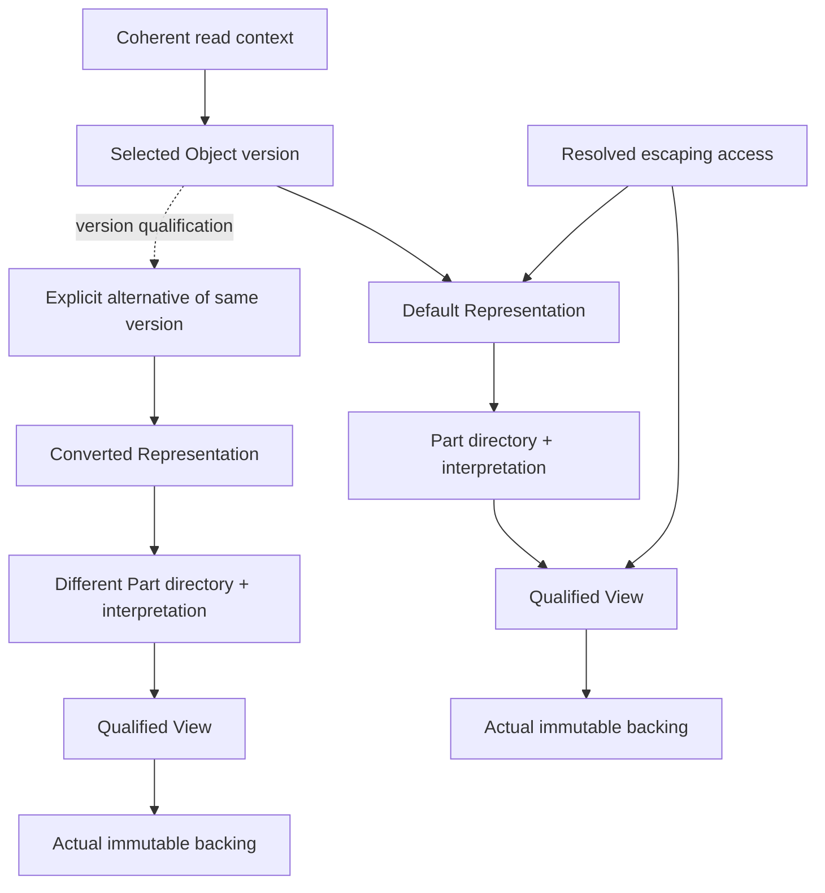
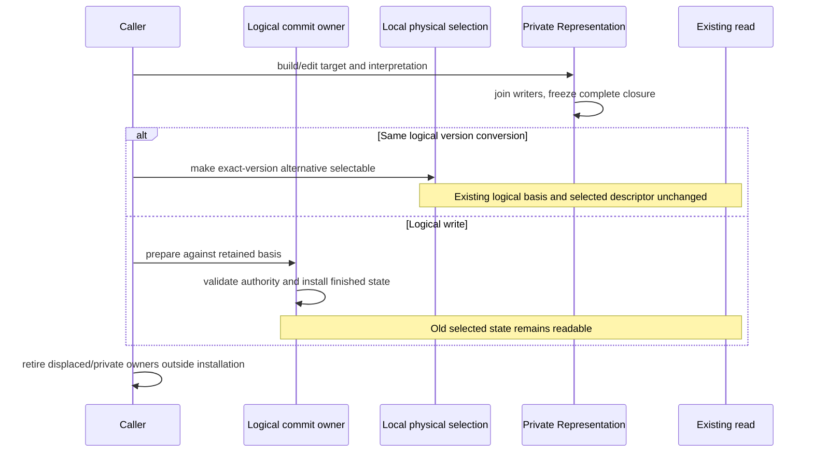

# Orbital Stage 2: structure exercised before implementation

9 October 2026. These experiments explored **Orbital Objects, Representations and
Views for embedded versioned reads and writes**. Their types and algorithms are
prototypes, not runtime contracts. The temporary consumer exercises real Ikea,
Allocation and Loom components. Engine and Ikea's composition of many blocks
remain open for Ashton to design. Stage 3's multiple workers are outside this pass.

The subsequent implementation was withdrawn and is now a rejected experimental
baseline in the [Orbital MVCC investigation](../orbital-mvcc/README.md).
Its [Object behavior](../orbital-mvcc/baseline/objects.md),
[consumer](../orbital-mvcc/consumer/README.md) and
[comparison](../orbital-mvcc/performance/README.md) describe that candidate,
not runtime contracts. Future promotion requires measurements to steer the
architecture and implementation from the first candidate. The evidence and
prototype limitations below retain their original experiment cutoff.

## The structure to carry forward

The useful division is selected logical state, a complete immutable physical
interpretation, and access to actual backing. A selected version reaches its
default Representation directly. Converting it creates another Representation
of that same version; it does not publish a logical edit. Existing access keeps
its original descriptor-qualified Part binding. The same numeric Part ID may
describe a different structure in another Representation.



The distinction between the context and resolved access matters. A context keeps
future discovery coherent across objects, parts and waits. Once discovery is
finished, an escaping access retains its exact Representation and backing. Here
that closure contains every dependency needed by the resolved read, so it need
not pin the entire selected State or unrelated objects. Any required logical
metadata, authority or unresolved obligation must also survive; finishing Part
discovery alone does not remove that obligation. Physical retention alone
supplies neither immutable contents nor valid interpretation.

The concrete caller passes native and ASan/UBSan checks, including the same
instrumentation in all 27 exercised project translation units. It changes eight
column Parts into one row Part, with both
descriptors live. It obtains one column View before waiting, discovers further
columns after conversion and a new logical publication, and decodes through the
original descriptor. A delayed conversion of v10 remains v10 after v11 publishes.
The [caller and its evidence](README.md) own the exact checked histories.

## Seams, signatures and translation units

The [selected-access prototype](../orbital-selected-access/access.h) has a small
public experiment header; its ordinary consumer includes no Journal, allocator
implementation or private catalog definition. Its three implementation units
separate mechanisms that have different costs and lifetimes:

| Prototype owner | Concrete surface | What the composition changed or clarified |
| --- | --- | --- |
| `version.cpp` | `Store::borrow/read`, `bind`, `Draft`, `CommitOwner::prepare/install`, `Prepared::retire` | Separate coherent selection from physical conversion; default Representation is directly reachable. The tiny vector catalog is a fixture, not a proposed directory algorithm. |
| `representation.cpp` | `Builder::make/write/freeze`, `capture`, `describe` | Adopt a completed immutable descriptor/backing closure. The first copying Builder signature would have copied every already encoded Ikea body again. `capture` copies descriptors and retains their owner instead. |
| `view.cpp` | `ready`, `RetainedView`, `Slot::submit/ready`, completion/receipt/retirement | Ready native use is a borrow. Waiting and escaping explicitly acquire the ownership they require. Replaceable backing has its own protection. |
| External caller | `consumer::word` and the conversion adapter | Interpretation, placement and semantic equivalence remain with the physical-format/data owner. Orbital qualifies selected identity and access; it does not learn schema, row membership or navigation. |

These are actual compiled signatures, not proposed production spelling:

```cpp
auto context = store.borrow();                    // uninterrupted current-owner use
auto selected = bind(context, object);            // borrowed selected descriptor
auto view = ready(*selected, part, requirements); // qualified native bytes
// Invoke the native Ikea operation while its bindings and owners stay valid.

auto retained = retain(context, *selected);       // explicit resolved escape
auto escaped = RetainedView::make(std::move(*retained), *view);

auto coherent = store.read();                    // retain discovery across a wait
// bind(coherent, ...) again after resumption, never silently substitute latest.
```

The prototypes reject temporary owners at borrowing call sites. They also exposed
two less obvious lifetime bugs: moving an access record must not leave its View
pointing into the old wrapper, and abandoning a Builder must not dangle an open
WriteView. This prototype retains private storage until the WriteView closes;
that policy does not grant write authority after a future Draft is revoked.
These protections belong around ownership transitions, outside each decoded
value's native path.

The current `ReadContext` combines owning and borrowed forms in one aggregate.
Likewise, `Selection`, `Requirements`, `View` and their result wrappers can create
large ordinary ABI boundaries. Their semantic separation is useful; their exact
representation is unsettled. Carry forward caller/callee evidence before choosing
smaller distinct borrow/owner types or a compiler-visible qualify/use helper.
Replacing every result with an output parameter is not a design conclusion.

The [compiled word caller](../orbital-selected-access/README.md#costs-and-simpler-shapes)
has a 96-byte frame with a reused Selection and 144 bytes when it also binds from
ReadContext. On that build, Requirements and `expected<View>` are each 40 bytes.
This favors qualifying once around reusable native work; the experiment's
fixed-word fusion omits general validation and does not replace the checked API.

The production split should keep state mutation/publication, descriptor building
and slow residency out of hot headers. Expose only the private leaf structures
and helpers needed by a measured friend/fused read body. Including the entire
catalog, allocator or request implementation to achieve inlining would defeat
the separation this pass is testing.

## Publication and conversion are different operations



Only the local basis/prepare/swap/retire portion is implemented in this spike.
It is **not** evidence for admitted-input, transaction-decision or outcome
provenance. The implementation must preserve those commit-owner obligations from
the [Journal specification](../../../orbital/spec/JOURNAL.md), while Object/View
consumers need no Journal dependency. Physical conversion must not change logical
contribution/deduplication identity or supply permission to publish.

The [material specification](../../../orbital/spec/MATERIAL.md) further separates
retained interpretation/material from recovery authority and unresolved
future-result obligations. These fixtures select completed embedded states;
they do not implement pending distributed cuts, recovery barriers or durable
custody transfer. The [physical lifetime specification](../../../orbital/spec/RUNTIME.md)
keeps completion, receipt, cancellation and safe physical retirement distinct.
The deterministic backend exercises those distinctions without claiming a Port
implementation or cross-worker reclamation.

## Performance decisions from the experiments

The [conversion fixture](../orbital-representation-conversion/FINDINGS.md) uses
actual SeriesPack/TuplePack kernels and Allocation/Hold backing. No production
Ikea adapter was needed. Conversion currently stages eight-u64 records and
initializes diagnostic sentinels; its timings and scratch estimates describe
that qualification fixture, not an optimized converter. Streaming/chunking
conversion can later reduce staging memory without changing the immutable
capture seam. The retained source and completed destination still coexist;
reducing that overlap would require a separate ownership/reconstruction argument.

The [single-operation experiment](../call-boundaries/critical-paths/) compares
outlined class seams, compiler-visible friends and manual fusion over current
packed lookup and real decoding. Stage 1's native lookup already inlined much
of this work: defeating an artificially outlined chain establishes a seam to
avoid, not recovered Stage 1 performance. The useful additional comparison is
visible versus fused, with the actual native consumer retained as a correctness
and static-code control. This pass supplies no matched native-driver timing win.
Its integer/SIMD/FP variants exploit the exact Local20 range only; this is no
license to route arbitrary 64-bit values through floating point.

The promising simplification is dependency depth: fixed admitted offsets replace
loads of plan pointers, bases, strides, shifts and masks before payload access.
The inspected Zen5 payload leaf has 22 memory-source reads in the visible arm
versus five in fused, before register restoration. Its complete query also saves
two GPRs instead of six. Those stack sites are register preservation, not evidence
of payload spills or failed store forwarding. Keep this explanation separate
from the aggregate materialization found in the selected-access word caller.

The corrected LLVM-MCA regions cover the successful found-row payload tail,
including its output stores. Modeled block reciprocal throughput is 11.3 → 7.3
cycles for visible → fused on V2, and 13.3 → 8.0 on Zen5. The FP variants are
8.5/9.0 cycles respectively; this instance does not favor moving work to FP.
These are scheduling-model estimates, excluding search, branch behavior,
selection and cache misses. They are neither complete-operation latency nor
hardware IPC evidence. Region checks preserve AArch64 immediate operands and
refuse internal branches/calls instead of silently removing them.

The [interleaving experiment](../call-boundaries/access-interleaving/) keeps
selected ownership and immutable bindings in a stable Frame, and carries small
recurrent work state through the native Ring. It compares sequential work,
manual widths and Rings with matched work and varied addresses. Code growth and
register pressure matter alongside throughput: full manual width-eight bodies
are substantially larger than one reusable Ring callback. Keep a direct ready
single-read path; independent memory chains are a separate opportunity.

| Local interleaving diagnostic | Serial | Manual | Ring |
| --- | ---: | ---: | ---: |
| Hot 32 KiB, width 2 with hints | 9.10 ns/read | 7.55 ns/read | 10.54 ns/read |
| Larger population, width 8 with hints | 134.38 ns/read | 28.59 ns/read | 24.74 ns/read |

These are medians of seven batch reciprocal-throughput samples over one reused
selected interpretation. Selection/binding costs are outside the timed work.
The larger population touches about 22.6 MiB of distinct rows within a 64 MiB
allocation; this is no cache-residency guarantee. Native source association is
post-run/provisional, with no demonstrated mismatch. The independently compiled
V2/Zen5 callback occupies 2,268/2,078 bytes versus 24,248/22,730 bytes for manual
width eight. Static sites enumerate alternative paths, not normalized executed
costs or a measured IPC explanation.

Neither local diagnostic establishes performance on V2/Zen5 hardware or a
versioned win against LMDB. The retained [Stage 1 comparison](../../benchmarks/orbital/evidence/selected-allocation-20261007/README.md)
still controls that claim: large point hits were 790 ns versus 700 ns p50, and
large random insert p99 was 10.710 µs versus 7.640 µs. Those primary cells already
omitted per-point Hold/Buffer/Lock work. Native borrowing prevents new versioning
overhead; it does not explain away those existing deficits. Matched snapshot
scope and complete query work remain necessary in the eventual composed panel.

## Questions handed to the subsequent candidate

- Choose compact frequent call shapes from the caller/ABI evidence, while
  retaining the distinct lifetime semantics above. A spike's `shared_ptr`,
  `std::vector` or error enum is not automatically the production representation.
  Keep bounded recurrent work state fixed; construction may grow a descriptor
  before freezing it. The fixture's eight-field limit supplies no production
  maximum for Parts, and hard-coding it would conflate test shape with architecture.
- Replace the copied vector State/catalog and synchronous destruction fixture
  when real ownership and workload require it. These experiments do not choose
  persistent directory geometry or establish bounded reclamation costs.
- Connect prepare/install to the embedded commit authority, including the
  admitted-input/provenance obligation; preserve future protocol boundaries.
- Give a real asynchronous backend ownership of outstanding work through
  physical retirement. Here the harness retains each Request through
  `finish`/`settle`/`retire`; dropping it is not a modeled backend.
- Carry physical equivalence/interpretation qualification through real
  construction. Part IDs are local to a Representation; format equality alone
  does not make two descriptors interchangeable.
- The opaque completed fixture owner retains all its Parts. Narrowing from
  whole-State to exact-Representation retention is demonstrated; optimal
  single-Part backing retention is not. Preserve the complete interpretation
  while separating physical protection where lifetimes differ, without adding
  independent per-Part ownership where one immutable owner already suffices.

These are localized implementation questions. They leave Engine navigation,
multi-block container structure and later multi-worker policy unconstrained.

All four owning spikes and this composed caller have native and ASan/UBSan
qualification. Checks exposed real lifetime/ownership and harness errors before
the results were retained. The selected-access source receipt and critical-path
C++ codegen identities were checked against the final files; the interleaving
native-source association has the narrower provenance stated above. Runtime
modules were unchanged at this experiment's cutoff. These prototype signatures
were not promoted to contracts; the later withdrawn baseline and comparison
linked above retain the subsequent implementation outcomes.
